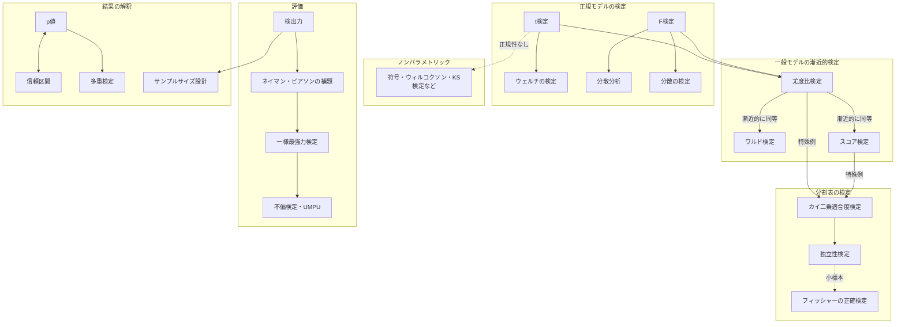

# 仮説検定

## 1. 全体像

仮説検定は「**検定統計量をどう作るか(手法)**」と「**作った検定をどう評価するか(評価)**」の2本立て。



**基本の枠組み**

- 帰無仮説 $H_0$、対立仮説 $H_1$。検定統計量 $T$ が棄却域 $R$ に入れば $H_0$ を棄却する。
- 第1種の過誤:$H_0$ が真なのに棄却する。確率 $\le\alpha$(有意水準)に抑える。
- 第2種の過誤:$H_0$ が偽なのに棄却しない。確率 $\beta$。
- 検出力:$1-\beta=P_\theta(T\in R)\ (\theta\in H_1)$。

---

## 2. 正規モデルの検定

### 2.1 t検定

**どのような検定か**:正規母集団で、分散 $\sigma^2$ が未知のときの平均に関する検定。統計量は、標準化の分母の $\sigma$ を標本標準偏差 $s$ で置き換えたもの。

**前提条件**

- 標本が正規分布 $N(\mu,\sigma^2)$ に従う(大標本では中心極限定理により緩む)。
- 独立な観測。
- $\sigma^2$ は未知。

**代表的な形**

| 検定 | 統計量 | $H_0$ での分布 |
|---|---|---|
| 1標本($H_0:\mu=\mu_0$) | $t=\dfrac{\bar X-\mu_0}{s/\sqrt n}$ | $t(n-1)$ |
| 2標本・等分散($H_0:\mu_1=\mu_2$) | $t=\dfrac{\bar X_1-\bar X_2}{s_p\sqrt{1/n_1+1/n_2}}$ | $t(n_1+n_2-2)$ |
| 対応あり | 差 $d_i$ に1標本の検定 | $t(n-1)$ |

プールした分散は $s_p^2=\dfrac{(n_1-1)s_1^2+(n_2-1)s_2^2}{n_1+n_2-2}$。等分散でないときは、自由度を修正するウェルチの検定を使う。

**棄却域**($H_1:\mu\ne\mu_0$ の両側検定):$|t|>t_{\alpha/2}(n-1)$。片側なら $t>t_\alpha(n-1)$ など。

**背景**:分子は正規分布、$\sqrt{(n-1)s^2/\sigma^2\big/(n-1)}$ は $\chi^2$ 由来で、$\bar X$ と $s^2$ は独立(→[正規母集団の標本分布](正規母集団の標本分布.md))。そのため比が $t$ 分布になる。

### 2.2 F検定

**どのような検定か**:2つの正規母集団の **分散の比** に関する検定。回帰分析・分散分析では、複数係数をまとめて検定するのにも使う。

**前提条件**:2つの独立な標本が、それぞれ正規分布 $N(\mu_i,\sigma_i^2)$ に従う。正規性からのずれに敏感。

**統計量と棄却域**($H_0:\sigma_1^2=\sigma_2^2$)

$$
F=\frac{s_1^2}{s_2^2}\sim F(n_1-1,\,n_2-1)\quad(H_0\text{ のもとで})
$$

- 両側検定:$F<F_{1-\alpha/2}(n_1-1,n_2-1)$ または $F>F_{\alpha/2}(n_1-1,n_2-1)$ で棄却。
- 片側($H_1:\sigma_1^2>\sigma_2^2$):$F>F_\alpha(n_1-1,n_2-1)$。

**回帰・分散分析での使い方**

線形制約の検定(例:$q$ 個の係数が全部0)では、制約あり・なしの残差平方和 $\mathrm{RSS}_0,\mathrm{RSS}_1$ から

$$
F=\frac{(\mathrm{RSS}_0-\mathrm{RSS}_1)/q}{\mathrm{RSS}_1/(n-k)}\sim F(q,\,n-k)
$$

**t検定との関係**:$t\sim t(m)$ なら $t^2\sim F(1,m)$。係数1個の検定ではどちらを使っても同じ結論になる。

---

## 3. 一般モデルの漸近的検定(三大検定)

設定:パラメータ $\theta\in\mathbb R^p$、$H_0:\theta=\theta_0$(または $q$ 個の制約)。尤度 $L(\theta)$、対数尤度 $\ell(\theta)$、最尤推定量 $\hat\theta$、フィッシャー情報量 $I(\theta)$。

> **注記:$I(\theta)$ は「データ1個あたり」のフィッシャー情報量**です($I_n(\theta)=nI(\theta)$ が全データ分)。ワルド統計量に $n$ が、スコア統計量に $\frac1n$ が掛かっているのは、そのためです。
>
> | | $I$ を1個分($I$)とする場合 | $I$ を全データ分($I_n=nI$)とする場合 |
> | --- | --- | --- |
> | ワルド | $n\,(\hat\theta-\theta_0)^\top I(\hat\theta)(\hat\theta-\theta_0)$ | $(\hat\theta-\theta_0)^\top I_n(\hat\theta)(\hat\theta-\theta_0)$ |
> | スコア | $\frac1n\,s(\theta_0)^\top I(\theta_0)^{-1}s(\theta_0)$ | $s(\theta_0)^\top I_n(\theta_0)^{-1}s(\theta_0)$ |
>
> 2つの列は**まったく同じ値**です。どちらの書き方でも、$s(\theta_0)$ は**全データの**対数尤度の微分(スコア)とします。教科書や問題では $I$ がどちらを指すかが異なるので、使う前に確認してください。

**共通の前提条件**

- 正則条件(→[点推定](点推定.md) の3.9節):台が $\theta$ に依存しない、微分可能など。
- 識別可能性があり、最尤推定量が一致性・漸近正規性を持つ。
- $\theta_0$ はパラメータ空間の内点。
- 標本サイズ $n$ が大きい(漸近理論に基づく)。

### 3.1 尤度比検定

**どのような検定か**:帰無仮説のもとと全体で、尤度の最大値を比べる。$H_0$ の下でデータがどれだけ説明力を失うかを測る。

$$
\Lambda=\frac{\sup_{\theta\in H_0}L(\theta)}{\sup_{\theta\in\Theta}L(\theta)},\qquad
-2\log\Lambda=2\big[\ell(\hat\theta)-\ell(\hat\theta_0)\big]
$$

($\hat\theta_0$ は $H_0$ の制約下での最尤推定量。)

**棄却域**:$\Lambda$ が小さい($-2\log\Lambda$ が大きい)とき棄却。ウィルクスの定理により、$H_0$ の下で $-2\log\Lambda\xrightarrow{d}\chi^2(q)$($q$ は制約の個数)。

$$
-2\log\Lambda>\chi^2_\alpha(q)\ \Rightarrow\ H_0\text{ を棄却}
$$

**特徴**

- 制約あり・なしの **両方のモデルを推定** する必要がある。
- 入れ子のモデルの比較に使える。
- 変数変換(再パラメータ化)に対して不変。
- 正規モデルでは、t検定・F検定は尤度比検定の特殊例になる。

### 3.2 ワルド検定

**どのような検定か**:制約なしの最尤推定量 $\hat\theta$ が、$\theta_0$ からどれだけ離れているかを、その標準誤差で測る。

$$
W=n(\hat\theta-\theta_0)^\top I(\hat\theta)\,(\hat\theta-\theta_0)\ \xrightarrow{d}\ \chi^2(p)
$$

1パラメータなら、$W=\dfrac{(\hat\theta-\theta_0)^2}{1/(nI(\hat\theta))}$、つまり $z=\dfrac{\hat\theta-\theta_0}{\mathrm{SE}(\hat\theta)}$ の2乗。

**棄却域**:$W>\chi^2_\alpha(p)$(制約が $q$ 個なら $\chi^2(q)$)。

**特徴**

- **制約なしのモデルだけ** を推定すればよい。最も手軽で、回帰係数の $z$ 検定がこれ。
- 再パラメータ化に対して不変でない(同じ仮説でも、表し方で結果が変わる)。
- 情報量を $\hat\theta$ で評価するため、小標本・境界付近で精度が落ちやすい。

### 3.3 スコア検定(ラオ検定、ラグランジュ乗数検定)

**どのような検定か**:$\theta_0$ における対数尤度の傾き(スコア)が、0からどれだけ離れているかを測る。$H_0$ が正しければ、$\theta_0$ で尤度はほぼ最大になるはずで、傾きは0に近い。

$$
S=\frac{1}{n}\,s(\theta_0)^\top I(\theta_0)^{-1}s(\theta_0)\ \xrightarrow{d}\ \chi^2(p),\qquad
s(\theta_0)=\partial_\theta\ell(\theta_0)
$$

**棄却域**:$S>\chi^2_\alpha(p)$(制約が $q$ 個なら $\chi^2(q)$)。

**特徴**

- **帰無仮説の下のモデルだけ** を推定すればよい。対立仮説側のモデルが複雑なときに有利。
- 例:カイ二乗適合度検定のピアソン統計量は、スコア検定の一例。
- 回帰では、診断(不均一分散や系列相関の検定)によく使う。

**スコア $s$ と傾き**

$s(\theta)=\partial_\theta\ell(\theta)$ は対数尤度の傾き。最尤推定量では $s(\hat\theta)=0$ なので、$H_0$ が正しければ $\theta_0$ でも傾きは0に近い。$\theta_0$ が真値から遠いと斜面上にあり、傾きが大きくなる。

**ワルドの $I$ とスコアの $I^{-1}$ が逆になる理由**

どちらも「ずれ$^2$ ÷ 分散」の形で、見ている量が違う。

| | 見ている量 | その分散 | 統計量 |
|---|---|---|---|
| ワルド | $\hat\theta-\theta_0$(推定値のずれ) | $(nI)^{-1}$ | $(\hat\theta-\theta_0)^\top(nI)(\hat\theta-\theta_0)$ |
| スコア | $s(\theta_0)$(傾き) | $nI$ | $s^\top(nI)^{-1}s$ |

- 傾き $s$ は、$I$ が大きい(山が鋭い)ほどばらつきが **大きい**($\mathrm{Var}(s)=nI$)。
- 推定値 $\hat\theta$ は、$I$ が大きいほどばらつきが **小さい**($\mathrm{Var}(\hat\theta)=(nI)^{-1}$)。

**1次元での確認**

$\ell$ を $\theta_0$ のまわりで2次近似すると、傾き ≈ 曲率 × 頂上からの距離:

$$
s(\theta_0)\approx nI\,(\hat\theta-\theta_0)
$$

これを代入すると、

$$
\underbrace{\frac{s(\theta_0)^2}{nI}}_{\text{スコア統計量}}
=\frac{(nI)^2(\hat\theta-\theta_0)^2}{nI}
=\underbrace{nI\,(\hat\theta-\theta_0)^2}_{\text{ワルド統計量}}
$$

$I$ と $I^{-1}$ の違いは、傾きと推定値の換算($s\approx nI\cdot$ずれ)を吸収した結果で、2つは漸近的に同じ値になる。

**例:正規分布の平均**($\sigma^2$ 既知、$H_0:\mu=\mu_0$)

$$
s(\mu_0)=\frac{n(\bar x-\mu_0)}{\sigma^2},\quad I=\frac1{\sigma^2}
\ \Rightarrow\
S=\frac{s^2}{nI}=\frac{n(\bar x-\mu_0)^2}{\sigma^2}=z^2=W
$$

この場合は近似でなく厳密に一致する($\ell$ が $\mu$ の2次式のため)。

### 3.4 三大検定の比較

```
対数尤度 ℓ(θ)
        ●  ← θ̂(最尤推定量):ワルドは「θ̂ と θ₀ の距離」を見る
       / \
      /   \     尤度比は「ℓ の高さの差」を見る
     /     \
   θ₀       :  スコアは「θ₀ での傾き」を見る
```

| | 見るもの | 推定が必要なモデル | 漸近分布 |
|---|---|---|---|
| 尤度比 | $\ell$ の高さの差 | 帰無・全体の両方 | $\chi^2(q)$ |
| ワルド | $\hat\theta$ と $\theta_0$ の距離 | 全体のみ | $\chi^2(q)$ |
| スコア | $\theta_0$ での傾き | 帰無のみ | $\chi^2(q)$ |

- 3つは **漸近的に同等**($H_0$ と、$H_0$ に近い局所対立仮説の下で)。
- 有限標本では、一般に $W\ge\Lambda$ 統計量 $\ge S$ の順になる傾向があり(線形回帰の例)、結果が食い違うことがある。

---

### 3.5 ウィルクスの定理

**主張**:正則条件の下で、$H_0$ が真のとき

$$
-2\log\Lambda=2\big[\ell(\hat\theta)-\ell(\hat\theta_0)\big]\ \xrightarrow{d}\ \chi^2(q)\quad(n\to\infty)
$$

- $\hat\theta$:制約なしの最尤推定量、$\hat\theta_0$:$H_0$ の下での最尤推定量。
- 尤度比検定の棄却域 $-2\log\Lambda>\chi^2_\alpha(q)$ の根拠。分布を厳密に求めなくても使える。

**前提条件**

- 正則条件(→[点推定](点推定.md) の3.9節)、最尤推定量の一致性・漸近正規性。
- $H_0$ が真で、真の $\theta$ が **パラメータ空間の内点**(境界でない)。
- 入れ子のモデル($\Theta_0\subset\Theta$)で、$\Theta_0$ が滑らかな部分空間。

**直感**:$\ell$ を $\hat\theta$ のまわりで2次近似すると、$2[\ell(\hat\theta)-\ell(\theta_0)]\approx n(\hat\theta-\theta_0)^\top I(\hat\theta-\theta_0)$(ワルド統計量)となる。$\hat\theta$ は漸近的に正規なので、これは $\chi^2$ 分布に従う。制約された方向の分だけ自由度が残る。

#### 自由度 $q$ の求め方

$$
q=\dim(\Theta)-\dim(\Theta_0)
$$

- $\dim\Theta$:制約なしモデルの **自由パラメータ数**。
- $\dim\Theta_0$:帰無仮説の下のモデルの自由パラメータ数。
- 「帰無仮説で、独立に決められなくなったパラメータの数」と考える。

| 検定 | $\dim\Theta$ | $\dim\Theta_0$ | $q$ |
|---|---|---|---|
| $N(\mu,\sigma^2)$ で $H_0:\mu=\mu_0$ | 2($\mu,\sigma^2$) | 1($\sigma^2$) | 1 |
| 回帰で $H_0:\beta_1=\beta_2=0$ | $k$ | $k-2$ | 2 |
| 2群の平均が等しい($\sigma^2$ 共通) | 3($\mu_1,\mu_2,\sigma^2$) | 2($\mu,\sigma^2$) | 1 |
| $k$ 群の平均がすべて等しい | $k+1$ | 2 | $k-1$ |

**制約式の本数で数える場合**

$H_0:h(\theta)=0$($h$ は $r$ 個の式)なら、**独立な制約の本数** が $q$。

$$
q=\mathrm{rank}\!\left(\frac{\partial h}{\partial\theta^\top}\right)
$$

- 冗長な式(他の式から導ける式)は数えない。
- 例:$\beta_1=\beta_2,\ \beta_2=\beta_3,\ \beta_1=\beta_3$ の3本は、3本目が冗長で $q=2$。

**分割表の検定との対応**(自由度の数え方が同じ)

- 適合度検定:$\dim\Theta=k-1$(確率の和が1)、$\dim\Theta_0=m$(推定するパラメータ数)なので $q=k-1-m$。
- 独立性検定:$\dim\Theta=rc-1$、$\dim\Theta_0=(r-1)+(c-1)$ なので $q=(r-1)(c-1)$。

**注意**

- パラメータの個数ではなく、**確率分布を決める自由度** で数える。確率の和が1などの内在的な制約は、先に引く。
- $H_0$ がパラメータ空間の **境界上** の値を含む場合(分散が0、混合モデルの成分数など)は、通常の $\chi^2(q)$ にならない(混合型の $\chi^2$ 分布になる)。
- 小標本では $\chi^2$ 近似が悪いことがある。

---

## 4. 分割表の検定

### 4.1 カイ二乗適合度検定

**どのような検定か**:観測度数が、仮定した分布の期待度数にどれだけ合っているかの検定。

- $k$ 個のカテゴリの観測度数 $O_j$、帰無仮説の下での期待度数 $E_j=np_j$。

$$
\chi^2=\sum_{j=1}^k\frac{(O_j-E_j)^2}{E_j}\ \xrightarrow{d}\ \chi^2(k-1-m)
$$

$m$ はデータから推定したパラメータの個数。

**前提条件**

- 独立な観測で、各観測がちょうど1つのカテゴリに入る。
- 標本が大きい(目安:各 $E_j\ge5$)。足りなければカテゴリを併合する。
- 連続分布の場合は、区間に分けて度数化する。

**棄却域**:$\chi^2>\chi^2_\alpha(k-1-m)$。

**背景**:度数のベクトルが多項分布に従い、ピアソン統計量は多項分布の尤度比検定・スコア検定と漸近的に同等。

### 4.2 クロス表における独立性検定

**どのような検定か**:$r\times c$ のクロス表で、2つのカテゴリ変数が **独立か** の検定。

- $H_0$:$p_{ij}=p_{i\cdot}\,p_{\cdot j}$(行と列が独立)。
- 期待度数は周辺度数から推定する:$\hat E_{ij}=\dfrac{n_{i\cdot}\,n_{\cdot j}}{n}$。

$$
\chi^2=\sum_{i=1}^r\sum_{j=1}^c\frac{(O_{ij}-\hat E_{ij})^2}{\hat E_{ij}}\ \xrightarrow{d}\ \chi^2\big((r-1)(c-1)\big)
$$

**自由度の理由**:セル $rc$ 個から、合計の制約1個、行の周辺確率の推定 $r-1$ 個、列の周辺確率の推定 $c-1$ 個を引く。

$$
rc-1-(r-1)-(c-1)=(r-1)(c-1)
$$

これは適合度検定の自由度 $k-1-m$ に $k=rc$、$m=(r-1)+(c-1)$ を代入した形。

**前提条件**:各期待度数 $\hat E_{ij}\ge5$ 程度。小標本($2\times2$ で期待度数が小さい)では、フィッシャーの正確検定を使う。

**棄却域**:$\chi^2>\chi^2_\alpha\big((r-1)(c-1)\big)$。

**補足**:$2\times2$ 表では、イェーツの連続性補正が使われることもある。

---

### 4.3 (参考)尤度比検定の観点からの理解

**設定**:$k$ 個のカテゴリの観測度数 $O_1,\dots,O_k$($\sum O_j=n$)は多項分布に従う。

$$
L(p)\propto\prod_{j=1}^k p_j^{O_j}\qquad\Big(\sum p_j=1\Big)
$$

- 全体モデル:$p$ が自由($\dim\Theta=k-1$)。最尤推定量は $\hat p_j=O_j/n$。
- 帰無仮説:$H_0:p_j=p_{j0}$。期待度数は $E_j=np_{j0}$。

**尤度比統計量($G$ 統計量)**

$$
-2\log\Lambda=2\big[\ell(\hat p)-\ell(p_0)\big]=2\sum_{j=1}^kO_j\log\frac{O_j}{E_j}
$$

ウィルクスの定理により、$H_0$ の下で $\chi^2(q)$ に漸近的に従う($q$ は3.5節の方法で数える)。

**ピアソン統計量との関係(2次近似の導出)**

$G=2\sum_jO_j\log\dfrac{O_j}{E_j}$ から、ピアソン統計量を導く。

**Step 1:$x\log x$ のテイラー展開**

$f(x)=x\log x$ を $x=1$ のまわりで展開する。

$$
f'(x)=\log x+1,\quad f''(x)=\frac1x
\ \Rightarrow\ f(1)=0,\ f'(1)=1,\ f''(1)=1
$$

$$
x\log x=(x-1)+\frac12(x-1)^2+O\big((x-1)^3\big)
$$

(別の見方:$\log(1+u)=u-\tfrac{u^2}{2}+\cdots$ で $u=x-1$ とおくと、$x\log x=(1+u)\big(u-\tfrac{u^2}2+\cdots\big)=u+\tfrac{u^2}2+O(u^3)$。)

**Step 2:$G$ に代入する**

$x_j=O_j/E_j$ とおくと $O_j=E_jx_j$ なので、

$$
G=2\sum_jE_j\,x_j\log x_j
$$

$H_0$ が正しいか $n$ が大きいと $x_j\approx1$ なので、Step 1 を使う。

$$
G\approx2\sum_jE_j\Big[(x_j-1)+\frac12(x_j-1)^2\Big]
=2\sum_jE_j(x_j-1)+\sum_jE_j(x_j-1)^2
$$

**Step 3:1次の項が消える**

$E_j(x_j-1)=O_j-E_j$ で、$\sum_jO_j=\sum_jE_j=n$ なので、

$$
\sum_jE_j(x_j-1)=\sum_j(O_j-E_j)=n-n=0
$$

**Step 4:2次の項を整理する**

$$
\sum_jE_j(x_j-1)^2=\sum_jE_j\Big(\frac{O_j-E_j}{E_j}\Big)^2=\sum_j\frac{(O_j-E_j)^2}{E_j}
$$

**結論**

$$
G=2\sum_jO_j\log\frac{O_j}{E_j}\ \approx\ \sum_j\frac{(O_j-E_j)^2}{E_j}=\chi^2
$$

- 3次以降の項は $(x_j-1)^3$ のオーダーで、$H_0$ の下で $x_j-1=O(1/\sqrt n)$ なので、$G-\chi^2=O_p(1/\sqrt n)\to0$。
- つまり **ピアソンのカイ二乗統計量は、尤度比統計量 $G$ の2次近似** で、漸近的に同じ分布($\chi^2(q)$)に従う。
- 数値例:$E=(50,50)$、$O=(60,40)$ で、$\chi^2=4.00$、$G\approx4.03$。ほぼ一致する。
- 補足:ピアソンは尤度比とは独立に提案した統計量で、多項分布のスコア検定としても厳密に導ける。

**独立性検定の場合**

全体モデルの最尤推定量は $\hat p_{ij}=O_{ij}/n$、帰無モデル($p_{ij}=p_{i\cdot}p_{\cdot j}$)では $\hat E_{ij}=\dfrac{n_{i\cdot}n_{\cdot j}}{n}$。

$$
G=2\sum_{i,j}O_{ij}\log\frac{O_{ij}}{\hat E_{ij}}\ \approx\ \sum_{i,j}\frac{(O_{ij}-\hat E_{ij})^2}{\hat E_{ij}}
$$

自由度は $q=(rc-1)-\big[(r-1)+(c-1)\big]=(r-1)(c-1)$。

**三大検定との対応**

| 統計量 | 検定の分類 |
|---|---|
| $G=2\sum O\log(O/E)$ | 尤度比検定 |
| $\sum(O-E)^2/E$(ピアソン) | スコア検定(完全指定の場合) |
| $\sum(O-E)^2/O$(ネイマン) | ワルド検定に相当 |

- ピアソン統計量は、分母が帰無仮説の下の期待度数 $E_j$ で、$\theta_0$ での傾きを使うスコア検定の形。
- ワルド型は、分母を観測度数 $O_j$ にしたもの。
- 小標本では $G$ の方が $\chi^2$ 近似が良いとされ、$G$ 検定が使われることがある(期待度数が十分大きければ両者はほぼ一致)。

---

## 5. 検定方式の評価

### 5.1 検出力と「より強力」

有意水準 $\alpha$ の検定 $\phi$ に対して、**検出力関数**

$$
\pi_\phi(\theta)=P_\theta(\phi\text{ が棄却})=E_\theta[\phi(X)]
$$

($\phi(x)\in[0,1]$ は棄却する確率。確率化検定も含む。)

- **有意水準**:$\theta\in H_0$ で $\pi_\phi(\theta)\le\alpha$。
- **より強力**:同じ有意水準の2つの検定 $\phi,\phi'$ に対し、$H_1$ の $\theta$ で $\pi_\phi(\theta)\ge\pi_{\phi'}(\theta)$ なら、$\phi$ は $\phi'$ より強力。

誤り2種のトレードオフ:有意水準 $\alpha$ を固定して、検出力を最大にする検定を探す。

### 5.2 ネイマン・ピアソンの補題

**設定**:単純仮説どうしの検定 $H_0:\theta=\theta_0$ 対 $H_1:\theta=\theta_1$。

**主張**:次の形の検定が、有意水準 $\alpha$ で **最強力検定**(検出力最大)になる。

$$
\phi(x)=\begin{cases}1 & \dfrac{f(x;\theta_1)}{f(x;\theta_0)}>k\\[2mm] 0 & \dfrac{f(x;\theta_1)}{f(x;\theta_0)}<k\end{cases}
$$

$k$ は $P_{\theta_0}(\phi=1)=\alpha$ となるように決める(境界は確率化して調整)。つまり **尤度比が大きい領域から順に棄却域に入れる**。

**証明の考え方**

任意の検定 $\phi^*$(有意水準 $\alpha$ 以下)と比べる。

$$
\int(\phi-\phi^*)\big(f_1-kf_0\big)\,dx\ \ge0
$$

被積分関数は常に非負($f_1>kf_0$ では $\phi=1\ge\phi^*$、$f_1<kf_0$ では $\phi=0\le\phi^*$)。これを展開すると

$$
\pi_\phi(\theta_1)-\pi_{\phi^*}(\theta_1)\ \ge\ k\big(\alpha-\pi_{\phi^*}(\theta_0)\big)\ge0
$$

となり、$\phi$ の検出力が最大であることが分かる。

**直感**:1点あたりの「費用」(帰無仮説の下での確率 $f_0$)あたりの「得」(対立仮説の下での確率 $f_1$)の比が大きい点から順に棄却域に入れる、という貪欲法が最適。

### 5.3 一様最強力検定(UMP検定)

**定義**:複合対立仮説 $H_1:\theta\in\Theta_1$ に対し、有意水準 $\alpha$ の検定 $\phi^*$ が、**すべての** $\theta\in\Theta_1$ で他のどの検定よりも検出力が大きいとき、一様最強力検定という。

**どう見つけるか**

- ネイマン・ピアソンの棄却域が、対立仮説の個々の $\theta_1$ に依存しなければ、すべての $\theta_1$ に共通の最強力検定になり、UMP検定になる。
- **単調尤度比の性質**(MLR)があれば、片側検定のUMP検定が得られる(カーリン・ルービンの定理)。指数型分布族($T(x)$ が増加)でこの性質が成り立つ。

**例**:$N(\mu,\sigma^2)$($\sigma^2$ 既知)で $H_0:\mu=\mu_0$ 対 $H_1:\mu>\mu_0$ → $\bar X>c$ のz検定がUMP。

**限界**:両側対立仮説($H_1:\mu\ne\mu_0$)では、一般にUMP検定は存在しない(左右どちらかに強い検定が、もう一方では弱い)。そのため、検定のクラスを不偏検定に狭める。

### 5.4 不偏検定

**定義**:有意水準 $\alpha$ の検定 $\phi$ で、対立仮説の下の検出力が **常に $\alpha$ 以上**

$$
\pi_\phi(\theta)\le\alpha\ (\theta\in H_0),\qquad \pi_\phi(\theta)\ge\alpha\ (\theta\in H_1)
$$

であるもの。「帰無仮説が偽のときに棄却する確率が、真のときに棄却する確率を下回らない」という最低限の要請。

- 不偏でない検定は、対立仮説のどこかで検出力が $\alpha$ を下回り、むしろ帰無仮説を支持しやすくなってしまう。
- **一様最強力不偏検定(UMPU検定)**:不偏検定のクラスの中で、UMPとなる検定。
- 両側検定のz検定・t検定は、UMP検定ではないが **UMPU検定** になる(指数型分布族の枠組み)。
- UMP検定が存在すれば、自動的に不偏(常に棄却しない検定 $\phi\equiv\alpha$ と比べ、検出力が $\alpha$ 以上になるため)。

### 5.5 評価の関係

```
ネイマン・ピアソンの補題(単純 vs 単純の最強力)
        │ 対立仮説が複合で、棄却域が共通なら
        ▼
一様最強力検定(UMP):片側検定で存在(単調尤度比)
        │ 両側などで存在しないとき、不偏性で絞る
        ▼
一様最強力不偏検定(UMPU):両側のt検定・z検定
```

| 概念 | 対象 | 内容 |
|---|---|---|
| 検出力 | 1つの検定 | 対立仮説で棄却する確率 |
| 最強力 | 単純対立仮説 | ネイマン・ピアソンの尤度比検定 |
| 一様最強力 | 複合対立仮説 | すべての $\theta_1$ で最強力 |
| 不偏検定 | 検定のクラス | 検出力が常に $\alpha$ 以上 |
| UMPU | 不偏検定のクラス | その中での一様最強力 |

---

## 6. 補足項目(統計検定1級レベル)

### 6.1 p値

帰無仮説の下で、観測した統計量 $t_{obs}$ **以上に極端な値** が出る確率。

$$
p=P_{H_0}(T\ge t_{obs})\quad(\text{両側なら}\ P(|T|\ge|t_{obs}|))
$$

- $p\le\alpha$ なら棄却。$H_0$ が真なら、連続分布で $p\sim U(0,1)$。
- 「$H_0$ が真である確率」ではない。

### 6.2 信頼区間と検定の双対性

水準 $\alpha$ の検定を、すべての $\theta_0$ について行い、**棄却されない $\theta_0$ の集合** が $100(1-\alpha)\%$ 信頼区間になる。逆に、信頼区間が $\theta_0$ を含まないことと、$H_0:\theta=\theta_0$ の棄却は同値。

- 平均の信頼区間(分散未知):$\bar X\pm t_{\alpha/2}(n-1)\,s/\sqrt n$
- 分散の信頼区間:$\Big[\dfrac{(n-1)s^2}{\chi^2_{\alpha/2}(n-1)},\ \dfrac{(n-1)s^2}{\chi^2_{1-\alpha/2}(n-1)}\Big]$
- 信頼度95%は、「**同じ手順を繰り返すと95%の区間が真値を含む**」の意味で、特定の区間が95%の確率で含むわけではない。

### 6.3 分散に関する検定

正規母集団で $H_0:\sigma^2=\sigma_0^2$。

$$
\chi^2=\frac{(n-1)s^2}{\sigma_0^2}\sim\chi^2(n-1)
$$

両側なら $\chi^2<\chi^2_{1-\alpha/2}(n-1)$ または $\chi^2>\chi^2_{\alpha/2}(n-1)$ で棄却。

### 6.4 ウェルチの検定(等分散を仮定しない2標本)

$$
t=\frac{\bar X_1-\bar X_2}{\sqrt{s_1^2/n_1+s_2^2/n_2}},\quad
\nu\approx\frac{(s_1^2/n_1+s_2^2/n_2)^2}{\dfrac{(s_1^2/n_1)^2}{n_1-1}+\dfrac{(s_2^2/n_2)^2}{n_2-1}}
$$

$t$ 分布の自由度に、上の近似値 $\nu$(ウェルチ・サタースウェイト)を使う。等分散性の事前検定(F検定)を経ずに、最初からこちらを使うことが推奨される。

### 6.5 母比率の検定・フィッシャーの正確検定

- 比率($H_0:p=p_0$):$z=\dfrac{\hat p-p_0}{\sqrt{p_0(1-p_0)/n}}\approx N(0,1)$。小標本は二項検定。
- $2\times2$ 表で期待度数が小さいとき:周辺度数を固定した超幾何分布で、正確に $p$ 値を計算する。

### 6.6 ノンパラメトリック検定

分布の形を仮定しない検定。順位を使う。

| 検定 | 対応するパラメトリック検定 | 内容 |
|---|---|---|
| 符号検定 | 1標本・対応ありのt検定 | 差の正負の数 |
| ウィルコクソンの符号付順位検定 | 対応ありのt検定 | 差の順位和 |
| ウィルコクソンの順位和検定(マン・ホイットニー) | 2標本t検定 | 2群の順位和 |
| クラスカル・ウォリス検定 | 一元配置分散分析 | 多群の順位 |
| コルモゴロフ・スミルノフ検定 | 適合度検定 | 経験分布関数と分布関数の最大差 |

正規性が成り立たないときや、外れ値があるときに頑健。正規性が成り立つ場合の検出力は、t検定よりわずかに劣る(漸近相対効率は約0.955)。

### 6.7 分散分析(ANOVA)

$k$ 群の平均が等しいかを、**群間変動と群内変動の比** で検定する。

$$
F=\frac{S_B/(k-1)}{S_W/(n-k)}\sim F(k-1,\,n-k)
$$

$S_B$ は群間平方和、$S_W$ は群内平方和。前提は、正規性・等分散性・独立性。

### 6.8 多重検定

$m$ 個の検定を同時に行うと、全体の第1種の過誤が膨らむ($1-(1-\alpha)^m$)。

| 方法 | 内容 |
|---|---|
| ボンフェローニ補正 | 各検定を $\alpha/m$ で行う。FWER($1$つでも誤って棄却する確率)を $\alpha$ 以下に |
| ホルム法 | $p$ 値を昇順に並べ、$\alpha/(m-i+1)$ と順に比較。ボンフェローニより強力 |
| ベンジャミニ・ホッホベルグ法 | FDR(棄却したもののうち誤りの割合の期待値)を制御 |

### 6.9 検出力の計算とサンプルサイズ

$H_0:\mu=\mu_0$ 対 $H_1:\mu=\mu_1>\mu_0$($\sigma$ 既知)のとき、検出力 $1-\beta$ を満たす $n$ は

$$
n\ge\left(\frac{(z_\alpha+z_\beta)\,\sigma}{\mu_1-\mu_0}\right)^2
$$

効果量が小さいほど、$\sigma$ が大きいほど、多くのサンプルが必要。

### 6.10 ベイズ的な検定(参考)

事後確率やベイズ因子 $BF=\dfrac{P(x\mid H_1)}{P(x\mid H_0)}$ で仮説を比べる。頻度論の検定と違い、$H_0$ と $H_1$ の確率を直接比較できる。

---

## 7. まとめ

1. 正規モデルでは **t検定**(平均)と **F検定**(分散比・複数係数)を使う。
2. 一般のモデルでは、**尤度比・ワルド・スコア** の三大検定を、漸近的に $\chi^2$ 分布で行う。違いは「どのモデルを推定するか」と「何を見るか」。
3. カテゴリデータには **カイ二乗適合度検定** と **独立性検定**。どちらもピアソン統計量を使い、自由度は「セル数 $-1-$推定したパラメータ数」。
4. 検定の良さは、**検出力を最大化する** ことで測る。単純 vs 単純では **ネイマン・ピアソンの補題** が最強力検定を与え、複合対立仮説では **UMP検定**、存在しないときは **UMPU検定** を探す。
