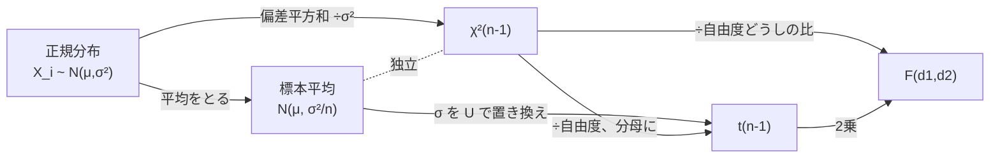

# 正規母集団の標本分布（標本平均・標本分散・$t$ 分布・$F$ 分布）

## 結論（3行まとめ）

1. **正規母集団 $N(\mu, \sigma^2)$ から $n$ 個を取ると、標本平均は $\bar{X} \sim N(\mu, \sigma^2/n)$、標本分散は $(n-1)U^2/\sigma^2 \sim \chi^2(n-1)$ で、この2つは独立です。** この「独立」が、$t$ 分布と $F$ 分布の土台になります。
2. **$t$ 分布は「標準正規 ÷ √（カイ二乗÷自由度）」、$F$ 分布は「カイ二乗÷自由度どうしの比」です。** どちらも密度は、ヤコビアンを使った2変数の変換（補助変数を足して積分）で導けます。
3. **使いどころ：** $\sigma$ が未知のときの平均の推定・検定は $T = \dfrac{\bar{X} - \mu}{U/\sqrt{n}} \sim t(n-1)$、2つの母集団の分散比の検定は $F$ 分布を使います。

> [!NOTE]
> 前提となる分布（$\chi^2$ 分布、ガンマ分布）は [代表的な確率分布](./代表的な確率分布.md)、密度の導出に使う変数変換は [2次元の変数変換とヤコビアン](./2次元の変数変換とヤコビアン.md)、独立性の議論は [多変量正規分布](./多変量正規分布.md) を参照してください。

---

## 0. 設定と記号

$X_1, \dots, X_n$ が独立に $N(\mu, \sigma^2)$ に従うとします（正規母集団からの無作為標本）。

| 記号 | 定義 |
| --- | --- |
| 標本平均 | $\displaystyle\bar{X} = \frac{1}{n}\sum_{i=1}^n X_i$ |
| 標本分散（不偏分散） | $\displaystyle U^2 = \frac{1}{n-1}\sum_{i=1}^n (X_i - \bar{X})^2$ |
| 偏差平方和 | $\displaystyle S_{xx} = \sum_{i=1}^n (X_i - \bar{X})^2 = (n-1)U^2$ |

> [!NOTE]
> $n$ で割る版 $\frac{1}{n}\sum(X_i - \bar{X})^2$ は標本分散（または $S^2$）と呼ばれ、期待値が $\frac{n-1}{n}\sigma^2$ になって不偏ではありません。このノートでは $n-1$ で割る不偏分散を $U^2$ と書きます。

---

## 1. 標本平均の分布

$$
\boxed{\ \bar{X} \sim N\!\left(\mu,\ \frac{\sigma^2}{n}\right)\ }
$$

**導出（積率母関数）**：$M_{X_i}(t) = e^{\mu t + \sigma^2t^2/2}$ で、独立な和の積率母関数は積なので、

$$
M_{\bar{X}}(t) = \prod_{i=1}^n M_{X_i}\!\left(\frac{t}{n}\right) = \exp\!\left(n\left[\mu\frac{t}{n} + \frac{\sigma^2}{2}\frac{t^2}{n^2}\right]\right) = \exp\!\left(\mu t + \frac{(\sigma^2/n)\,t^2}{2}\right)
$$

これは $N(\mu, \sigma^2/n)$ の積率母関数です。

- **平均は変わらず（不偏）、分散は $1/n$ になる**ので、標本が多いほど真の平均 $\mu$ の近くに集まります。
- 正規母集団なら、$n$ が小さくても**正確に**正規分布です（一般の母集団では、$n$ が大きいときに中心極限定理で近似）。
- $\sigma$ が既知なら、$Z = \dfrac{\bar{X} - \mu}{\sigma/\sqrt{n}} \sim N(0, 1)$ で検定・推定ができます。**問題は $\sigma$ が未知のとき**で、これを解決するのが $t$ 分布です。

---

## 2. 標本分散の分布

### 2-1. 結果

$$
\boxed{\ \frac{(n-1)U^2}{\sigma^2} = \frac{1}{\sigma^2}\sum_{i=1}^n (X_i - \bar{X})^2 \sim \chi^2(n-1)\ }
$$

かつ、**$\bar{X}$ と $U^2$ は独立**です。


$\mu = 10$、$\sigma = 2$、$n = 5$ で20万回シミュレーションしました。

| 量 | 理論値 | シミュレーション |
| --- | --- | --- |
| $\bar{X}$ の平均・分散 | $10,\ 0.8$ | $10.002,\ 0.798$ |
| $U^2$ の平均（不偏性） | $\sigma^2 = 4$ | $4.009$ |
| $U^2$ の分散 | $\dfrac{2\sigma^4}{n-1} = 8$ | $8.08$ |
| $\bar{X}$ と $U^2$ の相関 | $0$（独立） | $-0.003$ |

### 2-2. 準備：偏差平方和の分解

$X_i - \mu = (X_i - \bar{X}) + (\bar{X} - \mu)$ を2乗して足すと、交差項 $2(\bar{X}-\mu)\sum(X_i - \bar{X})$ が $\sum(X_i - \bar{X}) = 0$ で消えて、

$$
\sum_{i=1}^n (X_i - \mu)^2 = \sum_{i=1}^n (X_i - \bar{X})^2 + n(\bar{X} - \mu)^2
$$

$\sigma^2$ で割って意味を見ると、

$$
\underbrace{\sum_{i=1}^n\left(\frac{X_i - \mu}{\sigma}\right)^2}_{\chi^2(n)} = \underbrace{\frac{(n-1)U^2}{\sigma^2}}_{?} + \underbrace{\left(\frac{\bar{X} - \mu}{\sigma/\sqrt{n}}\right)^2}_{\chi^2(1)}
$$

左辺は $n$ 個の標準正規の2乗和で $\chi^2(n)$、右辺の第2項は標準正規1個の2乗で $\chi^2(1)$。**「？」が $\chi^2(n-1)$ で、第2項と独立であれば、積率母関数の積で辿りつく**、というのが次の導出の見通しです。

### 2-3. 導出：直交変換

$Z_i = (X_i - \mu)/\sigma$ とおくと、$Z_1, \dots, Z_n$ は独立な $N(0, 1)$ です。ベクトル $\vec{Z} = (Z_1, \dots, Z_n)^\top$ を、**第1行が $\left(\frac{1}{\sqrt{n}}, \dots, \frac{1}{\sqrt{n}}\right)$ の直交行列 $Q$**（$Q^\top Q = I$。たとえばヘルメルト行列）で変換します。

$$
\vec{Y} = Q\vec{Z}
$$

**① $\vec{Y}$ も独立な標準正規になる**：$\vec{Z}$ の密度は $(2\pi)^{-n/2}\exp\left(-\frac12\lVert\vec{z}\rVert^2\right)$ です。直交行列では $\lvert\det Q\rvert = 1$ なので、ヤコビアンは $1$。さらに $\lVert\vec{y}\rVert = \lVert\vec{z}\rVert$（長さを保つ）ので、

$$
f_{\vec{Y}}(\vec{y}) = (2\pi)^{-n/2}\exp\!\left(-\frac12\lVert\vec{y}\rVert^2\right)\cdot 1
$$

となり、$Y_1, \dots, Y_n$ は独立な $N(0, 1)$（[n次元の変数変換とヤコビアン](./n次元の変数変換とヤコビアン.md) 5-1）。

**② 各成分の意味**：

- 第1成分：$Y_1 = \dfrac{1}{\sqrt{n}}\sum Z_i = \sqrt{n}\,\bar{Z}$、つまり $Y_1^2 = n\bar{Z}^2 = \left(\dfrac{\bar{X} - \mu}{\sigma/\sqrt{n}}\right)^2$。
- 長さの保存：$\sum_{i=1}^n Y_i^2 = \sum_{i=1}^n Z_i^2$。

よって、

$$
\sum_{i=2}^n Y_i^2 = \sum_{i=1}^n Z_i^2 - n\bar{Z}^2 = \sum_{i=1}^n(Z_i - \bar{Z})^2 = \frac{(n-1)U^2}{\sigma^2}
$$

**③ 結論**：$Y_2, \dots, Y_n$ は独立な $N(0, 1)$ が $n-1$ 個なので、$\sum_{i\ge2}Y_i^2 \sim \chi^2(n-1)$。さらに、$Y_1$（$\bar{X}$ の関数）と $Y_2, \dots, Y_n$（$U^2$ の関数）は独立な成分なので、**$\bar{X}$ と $U^2$ は独立**です。

#### 2-3 の補足：直交行列 $Q$ の具体例（ヘルメルト行列）

上の導出では「第1行が $\left(\frac{1}{\sqrt{n}}, \dots, \frac{1}{\sqrt{n}}\right)$ の直交行列 $Q$ が存在する」ことだけを使いました。具体的に書き下せる標準的な例が、**ヘルメルト行列**です。

**一般の $n$**：第1行はすべて $\dfrac{1}{\sqrt{n}}$。第 $k$ 行（$k = 2, \dots, n$）は、**先頭の $k-1$ 個が同じ正の値、$k$ 番目が負の値、残りが $0$** です。

$$
\underbrace{\frac{1}{\sqrt{k(k-1)}},\ \dots,\ \frac{1}{\sqrt{k(k-1)}}}_{k-1\text{ 個}},\ \underbrace{-\frac{k-1}{\sqrt{k(k-1)}}}_{k\text{ 番目}},\ \underbrace{0,\ \dots,\ 0}_{n-k\text{ 個}}
$$

| 行 | 成分 |
| --- | --- |
| 1 | $\dfrac{1}{\sqrt{n}},\ \dots,\ \dfrac{1}{\sqrt{n}}$ |
| 2 | $\dfrac{1}{\sqrt{2}},\ -\dfrac{1}{\sqrt{2}},\ 0,\ 0,\ \dots$ |
| 3 | $\dfrac{1}{\sqrt{6}},\ \dfrac{1}{\sqrt{6}},\ -\dfrac{2}{\sqrt{6}},\ 0,\ \dots$ |
| 4 | $\dfrac{1}{\sqrt{12}},\ \dfrac{1}{\sqrt{12}},\ \dfrac{1}{\sqrt{12}},\ -\dfrac{3}{\sqrt{12}},\ 0,\ \dots$ |
| $\vdots$ | $\vdots$ |

**直交行列であることの確認**：

- **長さが 1**（第 $k$ 行）：$\dfrac{(k-1)\cdot1 + (k-1)^2}{k(k-1)} = \dfrac{k(k-1)}{k(k-1)} = 1$。
- **第1行と直交**：第 $k$ 行（$k \ge 2$）の成分の和は $(k-1)c - (k-1)c = 0$（$c = 1/\sqrt{k(k-1)}$）。第1行は定数なので、内積は和に比例して $0$。
- **第 $j$ 行と第 $k$ 行が直交**（$2 \le j < k$）：第 $k$ 行は先頭 $k-1$ 個が同じ値 $c_k$、第 $j$ 行は先頭 $j$ 個までしか $0$ でない。内積は $c_k\times(\text{第 }j\text{ 行の成分の和}) = c_k \times 0 = 0$。

**$n = 3$ の例**：

$$
Q = \begin{pmatrix}
\frac{1}{\sqrt{3}} & \frac{1}{\sqrt{3}} & \frac{1}{\sqrt{3}} \\[2pt]
\frac{1}{\sqrt{2}} & -\frac{1}{\sqrt{2}} & 0 \\[2pt]
\frac{1}{\sqrt{6}} & \frac{1}{\sqrt{6}} & -\frac{2}{\sqrt{6}}
\end{pmatrix}
$$

各成分は、$\vec{Z} = (Z_1, Z_2, Z_3)^\top$ に掛けると次のようになります。

- $Y_1 = \dfrac{Z_1 + Z_2 + Z_3}{\sqrt{3}} = \sqrt{3}\,\bar{Z}$
- $Y_2 = \dfrac{Z_1 - Z_2}{\sqrt{2}}$
- $Y_3 = \dfrac{Z_1 + Z_2 - 2Z_3}{\sqrt{6}}$

**一般の $n$ では**、$Y_k = \dfrac{Z_1 + \dots + Z_{k-1} - (k-1)Z_k}{\sqrt{k(k-1)}}$（$k \ge 2$）で、「最初の $k-1$ 個の和」と「$k$ 番目の $k-1$ 倍」の差を、長さを 1 にそろえたものです。

**数値で確認**（$n = 3$、$Z = (1, 2, 6)$）：

| 量 | 値 |
| --- | --- |
| $\bar{Z}$ | $3$ |
| $\sum(Z_i - \bar{Z})^2$ | $4 + 1 + 9 = 14$ |
| $Y_1$ | $5.196 = \sqrt{3}\cdot 3$ |
| $Y_2$、$Y_3$ | $-0.707$、$-3.674$ |
| $Y_2^2 + Y_3^2$ | $0.5 + 13.5 = 14$（$\sum(Z_i - \bar{Z})^2$ と一致） |

$n = 2, 3, 5, 8$ で $QQ^\top = I$ が成り立つこと、$n = 5$ の標準正規乱数30万組で $\vec{Y} = Q\vec{Z}$ の共分散が単位行列に一致すること（成分の差が最大 $0.005$）、$\sum_{i\ge2}Y_i^2 = \sum(Z_i - \bar{Z})^2$ が丸め誤差の範囲で成り立つことも確認しました。

> [!NOTE]
> - **2行目以降は、第1行と直交する正規直交ベクトルなら何でもよい**です（ヘルメルト行列は書き下せる一例）。**結論は $Q$ の選び方に依りません**。
> - $\det Q$ は $\pm1$ です（ヘルメルト行列では $n$ によって符号が変わる）。ヤコビアンは絶対値なので、どちらでも $\lvert J\rvert = 1$。

### 2-4. 別の見方：共分散が 0

$\operatorname{Cov}(\bar{X},\ X_i - \bar{X}) = \operatorname{Cov}(\bar{X}, X_i) - V[\bar{X}] = \dfrac{\sigma^2}{n} - \dfrac{\sigma^2}{n} = 0$。$(\bar{X}, X_1 - \bar{X}, \dots, X_n - \bar{X})$ は同時に正規分布なので、**無相関なら独立**（[多変量正規分布](./多変量正規分布.md) 3-3）。$U^2$ は $X_i - \bar{X}$ だけの関数なので、$\bar{X}$ と独立です。

> [!IMPORTANT]
> **$\bar{X}$ と $U^2$ が独立なのは、正規母集団の特徴です。** 一般の母集団では独立になりません。この性質があるので、$t$ 統計量の分子（$\bar{X}$）と分母（$U$）を別の確率変数として扱えます。

### 2-5. 性質

- $E[U^2] = \sigma^2$（不偏性）：$E\left[\chi^2(n-1)\right] = n-1$ より、$E\left[\frac{(n-1)U^2}{\sigma^2}\right] = n-1$。
- $V[U^2] = \dfrac{2\sigma^4}{n-1}$：$V[\chi^2(n-1)] = 2(n-1)$ より。
- **なぜ自由度が $n-1$ か**：$X_i - \bar{X}$ の $n$ 個は、$\sum(X_i - \bar{X}) = 0$ という**1つの制約**があり、自由に動けるのは $n-1$ 個だからです（直交変換で $Y_1$ に「平均の分」を取り分けた残りが $n-1$ 個）。

---

## 3. $t$ 分布

### 3-1. 定義

$Z \sim N(0, 1)$、$V \sim \chi^2(k)$ が**独立**のとき、

$$
T = \frac{Z}{\sqrt{V/k}} \sim t(k)\qquad(\text{自由度 }k\text{ の }t\text{ 分布})
$$

### 3-2. 密度の導出

補助変数 $W = V$ を足し、$(Z, V) \to (T, W)$ の変換を考えます。

**① 逆変換**：$z = t\sqrt{w/k}$、$v = w$。

**② ヤコビアン**：

$$
J = \det\begin{pmatrix}\partial z/\partial t & \partial z/\partial w \\ \partial v/\partial t & \partial v/\partial w\end{pmatrix}
= \det\begin{pmatrix}\sqrt{w/k} & * \\ 0 & 1\end{pmatrix} = \sqrt{\frac{w}{k}}
$$

（三角行列なので対角成分の積。$*$ は計算不要）。

**③ 同時密度**：$Z$ と $V$ は独立なので、密度の積に $\lvert J\rvert$ を掛けて、

$$
f_{T,W}(t, w) = \frac{1}{\sqrt{2\pi}}e^{-\frac{z^2}{2}}\cdot\frac{w^{k/2-1}e^{-w/2}}{2^{k/2}\Gamma(k/2)}\cdot\sqrt{\frac{w}{k}}
$$

$z^2 = t^2w/k$ を代入して $w$ をまとめると、

$$
f_{T,W}(t, w) = \frac{1}{\sqrt{2\pi k}\,2^{k/2}\Gamma(k/2)}\ w^{\frac{k+1}{2}-1}\exp\!\left(-\frac{w}{2}\left(1 + \frac{t^2}{k}\right)\right)
$$

**④ $w$ を積分して消す**：ガンマ関数の積分 $\displaystyle\int_0^\infty w^{a-1}e^{-bw}dw = \frac{\Gamma(a)}{b^a}$（$a = \frac{k+1}{2}$、$b = \frac12\left(1 + \frac{t^2}{k}\right)$）を使うと、

$$
\int_0^\infty w^{\frac{k+1}{2}-1}e^{-bw}dw = \Gamma\!\left(\frac{k+1}{2}\right)\left(\frac{2}{1 + t^2/k}\right)^{\frac{k+1}{2}}
$$

定数を整理すると（$2^{(k+1)/2} / (\sqrt{2\pi}\cdot 2^{k/2}) = 1/\sqrt{\pi}$）、

$$
\boxed{\ f_T(t) = \frac{\Gamma\!\left(\frac{k+1}{2}\right)}{\sqrt{k\pi}\ \Gamma\!\left(\frac{k}{2}\right)}\left(1 + \frac{t^2}{k}\right)^{-\frac{k+1}{2}}\ }
$$

> [!TIP]
> 範囲は $-\infty < t < \infty$ です。この導出のように、**「ガンマ関数の積分で $w$ を消す」** のは、ガンマ系の分布の変換で定番の手順です。

### 3-3. 標本からの $t$ 統計量

$Z = \dfrac{\bar{X} - \mu}{\sigma/\sqrt{n}} \sim N(0, 1)$、$V = \dfrac{(n-1)U^2}{\sigma^2} \sim \chi^2(n-1)$ で、2章より**独立**です。したがって、

$$
\boxed{\ T = \frac{\bar{X} - \mu}{U/\sqrt{n}} = \frac{Z}{\sqrt{V/(n-1)}} \sim t(n-1)\ }
$$

**未知の $\sigma$ が分子と分母で約分されて消える**のが、$t$ 分布の価値です。$\sigma$ を標本の $U$ で置き換えた代償が、自由度 $n-1$ の $t$ 分布（正規分布より裾が重い）です。


| 量 | 理論値 | シミュレーション（$n=5$） |
| --- | --- | --- |
| $P(\lvert T\rvert > 2.776)$（$t(4)$ の両側5%点） | $0.05$ | $0.0500$ |
| $P(\lvert Z\rvert > 1.96)$（$\sigma$ 既知） | $0.05$ | $0.0505$ |
| $P(\lvert T\rvert > 1.96)$（正規の点を誤用） | — | $0.1227$ |
| $T$ の分散 | $\dfrac{k}{k-2} = 2$ | $1.988$ |

**$\sigma$ が未知なのに $1.96$ を使うと、5%のつもりが約12%の誤りになります**（$n=5$）。右の図でも、$T$（赤）のほうが極端な値が出やすいことが分かります。

### 3-4. 性質

| 性質 | 内容 |
| --- | --- |
| 対称性 | $t = 0$ について左右対称 |
| 平均 | $0$（$k > 1$ のとき） |
| 分散 | $\dfrac{k}{k-2}$（$k > 2$ のとき）。常に $1$ より大きい |
| $k = 1$ | **コーシー分布**（平均が存在しない） |
| $k \to \infty$ | $N(0, 1)$ に近づく（$(1 + t^2/k)^{-(k+1)/2} \to e^{-t^2/2}$） |
| 裾 | 正規分布より重い（$t^{-(k+1)}$ で減衰）。$r$ 次モーメントは $r < k$ のときだけ存在 |
| 積率母関数 | **存在しない**（裾が重いため） |

**主な臨界値**（$t(k)$ の両側5%点）：

| $k$ | 1 | 2 | 4 | 9 | 29 | 100 | $\infty$ |
| --- | --- | --- | --- | --- | --- | --- | --- |
| 値 | $12.706$ | $4.303$ | $2.776$ | $2.262$ | $2.045$ | $1.984$ | $1.960$ |

### 3-5. 使い方

- **平均の信頼区間**（$\sigma$ 未知）：$\displaystyle\bar{X} \pm t_{\alpha/2}(n-1)\frac{U}{\sqrt{n}}$。
- **平均の検定**：$H_0: \mu = \mu_0$ のとき $T = \dfrac{\bar{X} - \mu_0}{U/\sqrt{n}} \sim t(n-1)$。
- **2標本（等分散を仮定）**：$\displaystyle T = \frac{\bar{X} - \bar{Y} - (\mu_1 - \mu_2)}{U_p\sqrt{1/n_1 + 1/n_2}} \sim t(n_1 + n_2 - 2)$。ただし $U_p^2 = \dfrac{(n_1 - 1)U_1^2 + (n_2 - 1)U_2^2}{n_1 + n_2 - 2}$（プールした分散）。

---

## 4. $F$ 分布

### 4-1. 定義

$V_1 \sim \chi^2(d_1)$、$V_2 \sim \chi^2(d_2)$ が**独立**のとき、

$$
F = \frac{V_1/d_1}{V_2/d_2} \sim F(d_1, d_2)\qquad(\text{自由度 }(d_1, d_2)\text{ の }F\text{ 分布})
$$

### 4-2. 密度の導出

$t$ 分布と同様に、補助変数 $W = V_2$ を足し、$(V_1, V_2) \to (F, W)$ とします。

**① 逆変換**：$v_1 = \dfrac{d_1}{d_2}fw$、$v_2 = w$。

**② ヤコビアン**：$\det\begin{pmatrix}\partial v_1/\partial f & \partial v_1/\partial w \\ \partial v_2/\partial f & \partial v_2/\partial w\end{pmatrix} = \det\begin{pmatrix}\frac{d_1}{d_2}w & * \\ 0 & 1\end{pmatrix} = \dfrac{d_1}{d_2}w$。

**③ 同時密度**：$C = \dfrac{1}{2^{(d_1+d_2)/2}\Gamma(d_1/2)\Gamma(d_2/2)}$ として、

$$
f_{F,W}(f, w) = C\,v_1^{\frac{d_1}{2}-1}e^{-\frac{v_1}{2}}\ v_2^{\frac{d_2}{2}-1}e^{-\frac{v_2}{2}}\cdot\frac{d_1}{d_2}w
= C\left(\frac{d_1}{d_2}\right)^{\frac{d_1}{2}}f^{\frac{d_1}{2}-1}\ w^{\frac{d_1+d_2}{2}-1}\exp\!\left(-\frac{w}{2}\left(1 + \frac{d_1}{d_2}f\right)\right)
$$

（$w$ の指数は $\frac{d_1}{2} - 1 + \frac{d_2}{2} - 1 + 1$）。

**④ $w$ を積分して消す**：3-2 と同じガンマ関数の積分で、$\displaystyle\int_0^\infty w^{\frac{d_1+d_2}{2}-1}e^{-bw}dw = \Gamma\!\left(\frac{d_1+d_2}{2}\right)\left(\frac{2}{1 + \frac{d_1}{d_2}f}\right)^{\frac{d_1+d_2}{2}}$。$2$ のべきが約分されて、

$$
\boxed{\ f_F(x) = \frac{\Gamma\!\left(\frac{d_1+d_2}{2}\right)}{\Gamma\!\left(\frac{d_1}{2}\right)\Gamma\!\left(\frac{d_2}{2}\right)}\left(\frac{d_1}{d_2}\right)^{\frac{d_1}{2}}x^{\frac{d_1}{2}-1}\left(1 + \frac{d_1}{d_2}x\right)^{-\frac{d_1+d_2}{2}}\qquad(x > 0)\ }
$$

### 4-3. 標本からの $F$ 統計量

2つの正規母集団 $N(\mu_1, \sigma_1^2)$、$N(\mu_2, \sigma_2^2)$ から、独立に $n_1$ 個、$n_2$ 個の標本を取ると、2章より $V_1 = \dfrac{(n_1-1)U_1^2}{\sigma_1^2} \sim \chi^2(n_1 - 1)$、$V_2 = \dfrac{(n_2-1)U_2^2}{\sigma_2^2} \sim \chi^2(n_2 - 1)$ で、独立です。

$$
\boxed{\ \frac{U_1^2/\sigma_1^2}{U_2^2/\sigma_2^2} = \frac{V_1/(n_1-1)}{V_2/(n_2-1)} \sim F(n_1 - 1,\ n_2 - 1)\ }
$$

**母分散 $\sigma_1^2, \sigma_2^2$ が未知でも、$\sigma_1^2 = \sigma_2^2$ なら $U_1^2/U_2^2 \sim F(n_1 - 1, n_2 - 1)$** なので、等分散性の検定に使えます。


$n_1 = 6$、$n_2 = 11$（$\sigma_1 = 2$、$\sigma_2 = 3$）で20万回シミュレーションしました。

| 量 | 理論値 | シミュレーション |
| --- | --- | --- |
| 分散比の平均 | $\dfrac{d_2}{d_2 - 2} = 1.25$ | $1.248$ |
| 分散比の分布 | $F(5, 10)$（KS 検定で適合） | $p = 0.83$ |
| $T^2$（$T\sim t(6)$）の分布 | $F(1, 6)$（KS 検定で適合） | $p = 0.52$ |

### 4-4. 性質

| 性質 | 内容 |
| --- | --- |
| 平均 | $\dfrac{d_2}{d_2 - 2}$（$d_2 > 2$ のとき）。$d_1$ に依存しない |
| 逆数 | $1/F \sim F(d_2, d_1)$ |
| $t$ との関係 | $T \sim t(k)$ なら $T^2 \sim F(1, k)$（$Z^2 \sim \chi^2(1)$ だから） |
| $d_2 \to \infty$ | $F(d_1, \infty) = \chi^2(d_1)/d_1$ |
| ベータ分布との関係 | $B = \dfrac{V_1}{V_1 + V_2} \sim Be\!\left(\frac{d_1}{2}, \frac{d_2}{2}\right)$、$F = \dfrac{d_2}{d_1}\cdot\dfrac{B}{1 - B}$ |
| 積率母関数 | 存在しない |

**ベータ分布との関係**は、$\chi^2 = Ga\left(\frac{d}{2}, \frac12\right)$ で、「ガンマの和と比がベータ分布」（[2次元の変数変換とヤコビアン](./2次元の変数変換とヤコビアン.md) 5-3）からそのまま出ます。**逆数の関係**があるので、$F$ の表は上側だけで足ります（下側の臨界値は逆数 $1/F_\alpha(d_2, d_1)$ で求める）。

**主な臨界値**（$F(d_1, d_2)$ の上側5%点）：

| $(d_1, d_2)$ | $(1, 10)$ | $(5, 10)$ | $(10, 10)$ | $(5, 5)$ |
| --- | --- | --- | --- | --- |
| 値 | $4.96$ | $3.33$ | $2.98$ | $5.05$ |

### 4-5. 使い方

- **等分散性の検定**：$H_0: \sigma_1^2 = \sigma_2^2$ のとき $F = U_1^2/U_2^2 \sim F(n_1 - 1, n_2 - 1)$（大きい方を分子にして上側確率を見ることが多い）。
- **分散分析（ANOVA）**：群間分散 ÷ 群内分散が $F$ 分布に従う。
- **回帰分析**：回帰全体の有意性の検定（$F$ 検定）。$k=1$ なら $T^2$ と同じ。

---

## 5. 分布どうしの関係



| 統計量 | 分布 | 使う場面 |
| --- | --- | --- |
| $\dfrac{\bar{X} - \mu}{\sigma/\sqrt{n}}$ | $N(0, 1)$ | 平均、$\sigma$ 既知 |
| $\dfrac{(n-1)U^2}{\sigma^2}$ | $\chi^2(n-1)$ | 分散の検定・推定 |
| $\dfrac{\bar{X} - \mu}{U/\sqrt{n}}$ | $t(n-1)$ | 平均、$\sigma$ 未知 |
| $\dfrac{U_1^2/\sigma_1^2}{U_2^2/\sigma_2^2}$ | $F(n_1 - 1, n_2 - 1)$ | 分散比 |

---

## 6. 試験での使い方

- **統計量の形から分布を判断する**：「標準正規 ÷ √（$\chi^2$/自由度）」なら $t$、「$\chi^2$/自由度 ÷ $\chi^2$/自由度」なら $F$。**独立であること**を必ず確認する。
- **自由度**：標本平均の分は引かれるので $n-1$。2標本の併合は $n_1 + n_2 - 2$。
- **$\bar{X}$ と $U^2$ の独立性**は、正規母集団の性質として使ってよい（直交変換または共分散 0 の議論で示せる）。
- **密度の導出**：補助変数 $W$ を足す → ヤコビアン（三角行列で対角成分の積）→ 同時密度 → ガンマ関数の積分で $W$ を消す。
- **$t$ 分布の分散** $k/(k-2)$ は $k > 2$ が条件、**平均**は $k > 1$ が条件。$k = 1$ はコーシー分布。

---

## まとめ

- **標本平均**：$\bar{X} \sim N(\mu, \sigma^2/n)$。**標本分散**：$(n-1)U^2/\sigma^2 \sim \chi^2(n-1)$。**2つは独立**（直交変換で示せる）。
- **$t$ 分布**：$T = Z/\sqrt{V/k}$。密度 $\propto (1 + t^2/k)^{-(k+1)/2}$。$\sigma$ 未知の平均の推定・検定。
- **$F$ 分布**：$F = (V_1/d_1)/(V_2/d_2)$。密度 $\propto x^{d_1/2-1}(1 + d_1x/d_2)^{-(d_1+d_2)/2}$。分散比の検定。
- **密度の導出**：補助変数を足し、2次元のヤコビアンで変換し、ガンマ関数の積分で消す。

---

## 図の作り方

図とシミュレーションの確認は [script/plot_sampling_distributions.py](./script/plot_sampling_distributions.py) で行っています。リポジトリのルートで次を実行すると `images/` に出力されます（導出した密度の式と scipy の値の一致、臨界値、$t$ と $F$ の性質の確認結果は標準出力に表示されます）。

```bash
uv run --with matplotlib --with numpy --with scipy python 一般教養/数理統計学/script/plot_sampling_distributions.py
```
