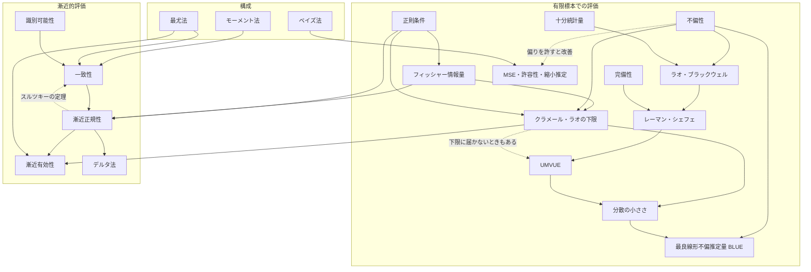

# 点推定

## 1. 全体像

点推定は「**推定量をどう作るか(構成)**」と「**作った推定量をどう評価するか(評価)**」の2本立て。



設定:$X_1,\dots,X_n \overset{iid}{\sim} f(x;\theta)$、推定量 $\hat\theta=\hat\theta(X_1,\dots,X_n)$。

---

## 2. 点推定の構成法

### 2.1 モーメント法

**アイデア**:データから計算できる平均(標本モーメント)と、$\theta$ で表される理論上の平均(理論モーメント)を等しいとおき、$\theta$ について解く。大数の法則より $m_k\to E_\theta[X^k]$ なので、標本の値が理論値に近いはず、という発想。

**手順**

1. パラメータ数を $p$ とする。
2. 理論モーメントを $\theta$ の関数として計算する:$\mu_k(\theta)=E_\theta[X^k]\ (k=1,\dots,p)$。
3. 標本モーメントを計算する:$m_k=\frac1n\sum_i X_i^k$。
4. 連立方程式 $\mu_k(\theta)=m_k\ (k=1,\dots,p)$ を解いた解を $\hat\theta_{MM}$ とする。

**例1:指数分布 $\mathrm{Exp}(\lambda)$**($p=1$)

$E[X]=1/\lambda$ なので、$1/\lambda=\bar X$ より $\hat\lambda=1/\bar X$。

**例2:正規分布 $N(\mu,\sigma^2)$**($p=2$)

$$
\mu=\bar X,\quad \sigma^2+\mu^2=\frac1n\sum X_i^2
\ \Rightarrow\ \hat\mu=\bar X,\ \ \hat\sigma^2=\frac1n\sum(X_i-\bar X)^2
$$

**例3:ガンマ分布 $\mathrm{Ga}(\alpha,\beta)$**(形状 $\alpha$、率 $\beta$)

$E[X]=\alpha/\beta,\ \mathrm{Var}[X]=\alpha/\beta^2$ なので、標本分散を $S_n^2=\frac1n\sum(X_i-\bar X)^2$ として

$$
\hat\alpha=\frac{\bar X^2}{S_n^2},\qquad \hat\beta=\frac{\bar X}{S_n^2}
$$

最尤法では閉じた形で解けないが、モーメント法なら代数的に解ける。

**性質・注意点**

- 長所:計算が簡単。一致性は大数の法則と連続写像定理から従う。
- 短所:漸近分散が最尤推定量より大きく、効率が悪いことが多い。
- 推定値がパラメータ空間の外に出ることがある(例:推定した分散が負になる)。
- 同じ分布でも、使うモーメントの選び方で推定量が変わる(一意でない)。
- 最尤法の数値最適化の初期値によく使う。
- 拡張として、モーメント条件の本数をパラメータ数より増やす一般化モーメント法(GMM)がある。

### 2.2 最尤法

**アイデア**:観測されたデータが **最も起こりやすくなる** $\theta$ を推定値とする。

**尤度と対数尤度**

$$
L(\theta)=\prod_{i=1}^n f(X_i;\theta),\qquad
\ell(\theta)=\log L(\theta)=\sum_{i=1}^n\log f(X_i;\theta)
$$

積を和にすると微分しやすく、$\log$ は単調増加なので最大点は変わらない。

**手順**

1. 対数尤度 $\ell(\theta)$ を書く。
2. スコア関数 $s(\theta)=\ell'(\theta)$ を求め、スコア方程式 $s(\theta)=0$ を解く。
3. 2階微分 $\ell''(\theta)<0$ で最大であることを確認する(多次元ならヘッセ行列が負定値)。
4. 境界で最大になる場合は、微分せず直接比較する。

$$
\hat\theta_{ML}=\arg\max_\theta \ell(\theta)
$$

**例1:ベルヌーイ$(p)$**

$$
\ell(p)=\sum x_i\log p+(n-\sum x_i)\log(1-p),\quad
\ell'(p)=\frac{\sum x_i}{p}-\frac{n-\sum x_i}{1-p}=0\ \Rightarrow\ \hat p=\bar X
$$

**例2:正規分布 $N(\mu,\sigma^2)$**

$$
\ell(\mu,\sigma^2)=-\frac n2\log(2\pi\sigma^2)-\frac1{2\sigma^2}\sum(x_i-\mu)^2
$$

$\mu$ で微分して $\hat\mu=\bar X$、$\sigma^2$ で微分して $\hat\sigma^2=\frac1n\sum(x_i-\bar X)^2$。
この場合はモーメント法と一致するが、$\hat\sigma^2$ は不偏ではない(不偏分散は $1/(n-1)$ 版)。

**例3:一様分布 $U(0,\theta)$**

尤度は $\theta^{-n}\,\mathbf 1\{\theta\ge \max X_i\}$ で、$\theta$ について単調減少かつ $\theta\ge\max X_i$ が必要なので、$\hat\theta=\max X_i$。
微分では求まらない例で、台が $\theta$ に依存するため正則条件も満たさない。

**解が閉形式で出ないとき**:ニュートン法・スコア法・EM アルゴリズムなどで数値的に最大化する。

**性質**

- 不変性:$g(\hat\theta)$ は $g(\theta)$ の最尤推定量。
- 正則条件と識別可能性の下で、一致性・漸近正規性・漸近有効性を持つ。
- 十分統計量の関数になる。
- 指数型分布族ではモーメント一致 $E_\theta[T]=\frac1n\sum T(x_i)$ と等価(→[十分統計量・因子分解・指数型分布族](十分統計量・因子分解・指数型分布族.md))。
- 小標本ではバイアスがあり得る。尤度が多峰だと局所解に注意。

### 2.3 ベイズ法

**アイデア**:$\theta$ を確率変数とみなし、データを見る前の信念(事前分布)をデータで更新して事後分布を得る。推定値はその事後分布から決める。

**ベイズの定理**

$$
\pi(\theta\mid x)=\frac{L(\theta)\,\pi(\theta)}{\int L(\theta')\pi(\theta')\,d\theta'}\ \propto\ L(\theta)\,\pi(\theta)
$$

事後分布 $\propto$ 尤度 $\times$ 事前分布。

**手順**

1. 事前分布 $\pi(\theta)$ を決める(情報があれば反映、なければ無情報事前分布)。
2. 尤度 $L(\theta)$ を書き、事後分布を計算する。
3. 損失関数に応じて、事後分布から点推定を取り出す。

| 損失関数 | ベイズ推定量 |
|---|---|
| 2乗損失 $(\hat\theta-\theta)^2$ | 事後平均 $E[\theta\mid x]$ |
| 絶対損失 $\lvert\hat\theta-\theta\rvert$ | 事後中央値 |
| 0-1損失 | 事後最頻値(MAP) |

**例:ベルヌーイ$(p)$ とベータ事前分布(共役事前分布)**

事前分布を $p\sim\mathrm{Beta}(a,b)$ とし、成功が $s=\sum x_i$ 回なら、事後分布は

$$
p\mid x\sim\mathrm{Beta}(a+s,\ b+n-s),\qquad
\hat p_{Bayes}=\frac{a+s}{a+b+n}=\frac{n}{a+b+n}\bar X+\frac{a+b}{a+b+n}\cdot\frac{a}{a+b}
$$

最後の式は、標本平均と事前平均の **重み付き平均** になっている。$n$ が大きいほどデータ側の重みが増す。

**共役事前分布**:事後分布が事前分布と同じ族になる事前分布。計算が閉じる(正規-正規、ポアソン-ガンマなど)。指数型分布族には必ず共役事前分布が存在する。

**性質・注意点**

- MAP は $\ell(\theta)+\log\pi(\theta)$ の最大化で、最尤法に正則化項を足したものに相当する(正規事前分布は L2 正則化、ラプラス事前分布は L1 正則化)。
- $n\to\infty$ では事前の影響が消え、事後分布は最尤推定量の周りの正規分布に近づく(ベルンシュタイン・フォン・ミーゼスの定理)。
- 事前分布に依存する点が長所(情報を組み込める)でもあり、短所(主観性)でもある。
- 事後分布が解析的に求まらない場合は MCMC や変分推論を用いる。
- 点推定だけでなく、事後分布全体から不確実性(信用区間)が得られる。

**3手法の比較**

| | 考え方 | $\theta$ の扱い | 必要なもの | 長所 | 短所 |
|---|---|---|---|---|---|
| モーメント法 | 平均の一致 | 定数 | モーメントの式 | 簡単・閉形式 | 効率が悪い |
| 最尤法 | 尤度最大化 | 定数 | 確率モデル | 漸近有効 | 計算・小標本で偏り |
| ベイズ法 | 事後分布 | 確率変数 | モデルと事前分布 | 事前情報・不確実性 | 事前分布依存・計算量 |

---

## 3. 推定量の評価

### 3.1 不偏性

$$
E_\theta[\hat\theta]=\theta\quad(\forall\theta)
$$

- バイアス $b(\theta)=E_\theta[\hat\theta]-\theta$。
- 平均2乗誤差 $\mathrm{MSE}=\mathrm{Var}(\hat\theta)+b(\theta)^2$。
- 不偏でも良い推定量とは限らず、わずかなバイアスで分散を大きく減らす推定量(ベイズ・縮小推定)もある。

### 3.2 最良線形不偏推定量(BLUE)

観測の **線形結合** $\sum a_iX_i$ で表される不偏推定量のうち、分散が最小のもの。

- 線形回帰では、誤差が無相関・等分散ならば最小二乗推定量が BLUE(ガウス・マルコフの定理)。
- 正規性は不要。ただし推定量のクラスを線形に限定している点に注意。
- 線形に限らなければ、より分散の小さい推定量があり得る(正規誤差なら OLS は全不偏推定量中で最良)。

### 3.3 フィッシャー情報量

$$
I(\theta)=E_\theta\!\big[(\partial_\theta\log f(X;\theta))^2\big]=-E_\theta\!\big[\partial_\theta^2\log f(X;\theta)\big]
$$

- データが $\theta$ について持つ情報の量(尤度の曲率)。
- i.i.d. 標本全体では $I_n(\theta)=nI(\theta)$。
- 後半の等号は正則条件(微分と積分の交換)が必要。

**フィッシャー情報行列**(多次元パラメータ)

$\theta=(\theta_1,\dots,\theta_p)^\top$ のとき、$I(\theta)$ は $p\times p$ の **対称半正定値行列**。

$$
I(\theta)_{jk}=E_\theta\!\left[\frac{\partial\log f(X;\theta)}{\partial\theta_j}\cdot\frac{\partial\log f(X;\theta)}{\partial\theta_k}\right]
=-E_\theta\!\left[\frac{\partial^2\log f(X;\theta)}{\partial\theta_j\,\partial\theta_k}\right]
$$

ベクトルで書くと、スコアベクトル $s(\theta;X)=\nabla_\theta\log f(X;\theta)$ の共分散行列:

$$
I(\theta)=E_\theta\big[s\,s^\top\big]=\mathrm{Var}_\theta(s)=-E_\theta\big[\nabla^2_\theta\log f\big]
$$

- $p=1$ なら、これまでのスカラー $I(\theta)$ と一致。
- i.i.d. 標本全体では $I_n(\theta)=nI(\theta)$。
- 最尤推定量の漸近分散は $\mathrm{Var}(\hat\theta)\approx\dfrac1n I(\theta)^{-1}$(逆行列)。
- クラメール・ラオの下限は、行列版では $\mathrm{Var}(\hat\theta)-\dfrac1n I(\theta)^{-1}\succeq0$。
- ワルド検定・スコア検定の統計量に現れる($W=n(\hat\theta-\theta_0)^\top I(\hat\theta)(\hat\theta-\theta_0)$)。
- 例:$N(\mu,\sigma^2)$ で $\theta=(\mu,\sigma^2)$ なら、$I(\theta)=\begin{pmatrix}1/\sigma^2&0\\0&1/(2\sigma^4)\end{pmatrix}$。

### 3.4 クラメール・ラオの不等式

不偏推定量 $\hat\theta$ について、正則条件の下で

$$
\mathrm{Var}_\theta(\hat\theta)\ \ge\ \frac{1}{nI(\theta)}
$$

- 不偏推定量の分散の **下限**。等号を達成する推定量を **有効推定量** と呼ぶ。
- 等号成立は、スコア関数が $\hat\theta-\theta$ の定数倍になるとき。これは指数型分布族の平均パラメータで成立する。
- 一般のバイアスあり推定量では $\mathrm{Var}\ge \frac{(1+b'(\theta))^2}{nI(\theta)}$。

**証明**(正則条件の下)

$\hat\theta=T(X)$ を不偏推定量、$X$ を標本全体、$s(\theta;X)=\partial_\theta\log f(X;\theta)$ をスコアとする($\mathrm{Var}(s)=I_n=nI$)。

1. スコアの期待値は0(微分と積分の交換を使う):

$$
E[s]=\int\partial_\theta f\,dx=\partial_\theta\int f\,dx=\partial_\theta 1=0
$$

2. $\mathrm{Cov}(\hat\theta,s)=1$。$E[s]=0$ より $\mathrm{Cov}=E[\hat\theta s]$ で、$\partial_\theta f=s f$ を使うと:

$$
E[\hat\theta\,s]=\int T(x)\,\partial_\theta f\,dx=\partial_\theta E[\hat\theta]=\partial_\theta\theta=1
$$

3. コーシー・シュワルツの不等式:

$$
1=\mathrm{Cov}(\hat\theta,s)^2\le\mathrm{Var}(\hat\theta)\,\mathrm{Var}(s)=\mathrm{Var}(\hat\theta)\,nI(\theta)
\ \Rightarrow\ \mathrm{Var}(\hat\theta)\ge\frac1{nI(\theta)}
$$

- 使う道具は、微積分の交換(正則条件)・不偏性・コーシー・シュワルツの3つだけ。
- 等号成立は $s=c(\theta)(\hat\theta-\theta)$ のとき。
- バイアスがある場合は手順2で $\partial_\theta E[\hat\theta]=1+b'(\theta)$ となり、上の一般形の下限が得られる。

### 3.5 識別可能性

$$
\theta\neq\theta' \Rightarrow f(\cdot;\theta)\neq f(\cdot;\theta')
$$

- 異なるパラメータが異なる分布を与えること。
- これがないと、データが無限にあっても $\theta$ を決められず、**一致性の前提** が崩れる。

### 3.6 一致性

$$
\hat\theta_n\xrightarrow{P}\theta
$$

- サンプルを増やすと真値に近づく、という最低限の要請。
- 識別可能性と正則条件の下で、最尤推定量は一致性を持つ。モーメント法は大数の法則から一致。
- 不偏性とは独立:不偏でも一致でない推定量(例:$\hat\theta=X_1$)、一致でも不偏でない推定量(例:$S^2$ の $1/n$ 版)がある。

### 3.7 漸近正規性

$$
\sqrt n(\hat\theta_n-\theta)\xrightarrow{d}N(0,\ v(\theta))
$$

- 一致性より細かい、誤差の分布まで含めた性質。信頼区間や検定の根拠になる。
- 最尤推定量では $v(\theta)=1/I(\theta)$。

### 3.8 漸近有効性

漸近正規な推定量で、漸近分散が **クラメール・ラオの下限** $1/I(\theta)$ に一致するもの。

$$
\sqrt n(\hat\theta_n-\theta)\xrightarrow{d}N\!\Big(0,\frac1{I(\theta)}\Big)
$$

- 正則条件の下で **最尤推定量は漸近有効**。
- モーメント法は一般に漸近分散が $1/I(\theta)$ より大きい(漸近有効でない)。

---

### 3.9 正則条件

クラメール・ラオの不等式や最尤推定量の漸近理論(一致性・漸近正規性・漸近有効性)を成り立たせるために、モデルに課す技術的な条件の集まり。

**主な内容**

1. **台が $\theta$ に依存しない**:$f(x;\theta)>0$ となる $x$ の範囲が $\theta$ で変わらない。
2. **$\theta$ について十分滑らか**:$\log f$ が $\theta$ で2回(理論によっては3回)微分可能。
3. **微分と積分の交換が可能**:

$$
\frac{\partial}{\partial\theta}\int f\,dx=\int\frac{\partial f}{\partial\theta}\,dx
$$

4. **フィッシャー情報量が正で有限**:$0<I(\theta)<\infty$。
5. **真の $\theta$ がパラメータ空間の内点**にある(境界上だと漸近正規性が崩れ得る)。
6. 最尤法の理論では、さらに識別可能性や、3階微分が有界であることなど。

**なぜ必要か**

条件3があると、$\int f\,dx=1$ の両辺を $\theta$ で微分して $E_\theta[s(\theta;X)]=0$(スコアの期待値が0)を導ける。その結果、次が成り立つ。

- フィッシャー情報量の2通りの表現が一致する:$E[s^2]=-E[\partial_\theta^2\log f]$
- クラメール・ラオの下限が導ける。

**満たさない例**

一様分布 $U(0,\theta)$ は台 $[0,\theta]$ が $\theta$ に依存し、条件1を満たさない。クラメール・ラオの下限は使えず、最尤推定量 $\max X_i$ は通常の $\sqrt n$ より速い $n$ のオーダーで収束する。

---

### 3.10 UMVUEとラオ・ブラックウェル、レーマン・シェフェ

**(前提)十分統計量の定義**

統計量 $T=T(X)$ が $\theta$ の **十分統計量** であるとは、$T=t$ を与えたときのデータ $X$ の条件付き分布が $\theta$ に依存しないこと:

$$
P_\theta(X=x\mid T(X)=t)\ \text{が}\ \theta\ \text{によらない}
$$

- 意味:$T$ を知った後では、データの残りの部分から $\theta$ について何も分からない。$T$ が $\theta$ に関する情報を使い切っている。
- 確認の仕方(離散の場合):$P_\theta(X=x\mid T=t)=\dfrac{f(x;\theta)}{P_\theta(T=t)}$($T(x)=t$ のとき)。この式には同時密度 $f(x;\theta)$ が現れるため、十分性の判定は同時密度(尤度)の形を調べることになる。
- **因子分解定理**:$T$ が十分 $\iff f(x;\theta)=g\big(T(x),\theta\big)\,h(x)$($h$ は $\theta$ によらない)。$\theta$ に依存する部分が $T$ を通してだけ現れるとき、分母($T$ の確率)の $g$ と打ち消し合い、条件付き分布から $\theta$ が消える。
- 例:ベルヌーイ$(p)$ の同時確率 $p^{\sum x_i}(1-p)^{n-\sum x_i}$ は、$p$ を含む部分が $\sum x_i$ だけで決まるので、$\sum X_i$ が十分統計量(成功の順序は $p$ の推測に無関係)。
- 詳細は→[十分統計量・因子分解・指数型分布族](十分統計量・因子分解・指数型分布族.md)。

不偏推定量の中で、**すべての $\theta$ で分散が最小** のものをUMVUE(一様最小分散不偏推定量)という。クラメール・ラオの下限に届かない場合でも存在し得る。

- **ラオ・ブラックウェルの定理**:不偏推定量 $\hat\theta$ と十分統計量 $T$ に対し、$\tilde\theta=E[\hat\theta\mid T]$ は不偏で、分散は $\hat\theta$ 以下。つまり **十分統計量で条件付けると、分散は悪化しない**。
  - 証明は条件付き分散の公式 $\mathrm{Var}(\hat\theta)=E[\mathrm{Var}(\hat\theta\mid T)]+\mathrm{Var}(\tilde\theta)$ による。
- **完備性**:$E_\theta[g(T)]=0\ (\forall\theta)\Rightarrow g(T)=0$ a.s. となる性質。
- **レーマン・シェフェの定理**:完備十分統計量 $T$ の関数である不偏推定量は、UMVUE(一意)。
- 指数型分布族(full rank)の $\sum T(X_i)$ は完備十分統計量(→[十分統計量・因子分解・指数型分布族](十分統計量・因子分解・指数型分布族.md))。

**例**:ポアソン$(\lambda)$ の $e^{-\lambda}$ の推定。$\mathbf 1\{X_1=0\}$ は不偏。これを十分統計量 $\sum X_i$ で条件付けると $\big(1-\tfrac1n\big)^{\sum X_i}$ となり、これがUMVUE。

### 3.11 デルタ法

$\sqrt n(\hat\theta_n-\theta)\xrightarrow{d}N(0,v)$ で $g$ が微分可能、$g'(\theta)\ne0$ のとき

$$
\sqrt n\big(g(\hat\theta_n)-g(\theta)\big)\xrightarrow{d}N\big(0,\ g'(\theta)^2v\big)
$$

- 多次元では $\nabla g^\top V\nabla g$。
- 例:$\hat p=\bar X$ から、オッズ比や $\log\frac{p}{1-p}$ の漸近分散を求める。
- 一致性の連続写像定理、スルツキーの定理と併せて使う。

### 3.12 十分性・完備性まわりの補足

- **最小十分統計量**:十分統計量の中で、最も情報を縮約したもの。尤度比 $f(x;\theta)/f(y;\theta)$ が $\theta$ によらない $\Leftrightarrow T(x)=T(y)$ で判定。
- **補助統計量**:分布が $\theta$ に依存しない統計量。**バスの定理**:完備十分統計量は、すべての補助統計量と独立。

### 3.13 平均2乗誤差とミニマックス・許容性

- $\mathrm{MSE}=\mathrm{Var}+\text{bias}^2$。不偏にこだわらなければ、小さいMSEの推定量がある。
- **許容性**:すべての $\theta$ でMSEが同じか小さい別の推定量が存在しないこと。
- **スタインのパラドックス**:$N(\theta,I_p)$ の $p\ge3$ では、標本平均は許容的でない。ジェームズ・スタイン推定量(縮小推定)が、すべての $\theta$ でMSEが小さい。
- **ミニマックス推定量**:最悪の場合のリスクを最小にする推定量。

### 3.14 ブートストラップ・ジャックナイフ(参考)

分布を仮定せず、データの再抽出で、推定量の分散や信頼区間を近似する方法。

---

## 4. 相互関係のまとめ

```
識別可能性 ──→ 一致性 ──→ 漸近正規性 ──→ 漸近有効性
                                ↑              ↑
                         フィッシャー情報量 ─→ クラメール・ラオ下限
                                ↑
                  不偏性 ───────┘(有限標本の下限を与える)
```

| 概念 | 標本サイズ | 何を測るか |
|---|---|---|
| 不偏性 | 有限 | 平均的に真値に当たるか |
| BLUE | 有限 | 線形不偏の中での最小分散 |
| クラメール・ラオ | 有限 | 不偏推定量の分散の下限 |
| 識別可能性 | モデル | 一致性の前提条件 |
| 一致性 | 漸近 | 真値に収束するか |
| 漸近正規性 | 漸近 | 誤差の分布 |
| 漸近有効性 | 漸近 | 下限に到達するか |

### 構成法 × 評価の対応

| 構成法 | 不偏性 | 一致性 | 漸近有効性 |
|---|---|---|---|
| モーメント法 | 一般に× | ○ | 一般に× |
| 最尤法 | 一般に× | ○(識別可能性が必要) | ○(正則条件下) |
| ベイズ法 | ×(事前による偏り) | ○($n\to\infty$) | ○(漸近的に最尤と同等) |

## 5. 一言でまとめると

1. 推定量は **モーメント法・最尤法・ベイズ法** で作る。
2. 有限標本では **不偏性** を軸に、**フィッシャー情報量** から **クラメール・ラオの下限** で分散の良さを測る。線形に限れば **BLUE**。
3. 標本が大きい場合は、**識別可能性 → 一致性 → 漸近正規性 → 漸近有効性** の順に性質が積み上がる。
4. **最尤推定量** は正則条件下で、これらをすべて満たす。
