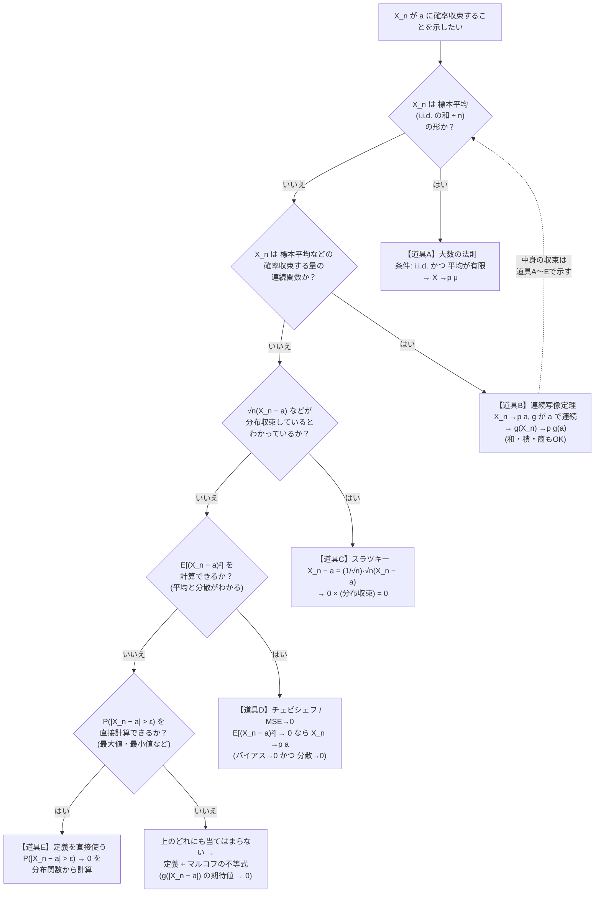

# 確率収束の証明：解き方フローチャート

「$X_n\xrightarrow{p}a$ を示せ」という問題で、**定義（$P(|X_n-a|>\varepsilon)\to0$）を直接使うのは最後の手段**です。
多くの場合は、下のフローチャートに従って**道具を選ぶ**だけで終わります。

関連：[確率変数と分布の収束](./確率変数と分布の収束.md)（定理の詳細）、[点推定](./点推定.md)（一致性）

---

## 1. フローチャート

読み方：上から順に当てはまるかを確認します。

- 道具 **B（連続写像定理）は「部品の収束」を別の道具で示す**ので、B を選んだら、部品（標本平均など）の収束を A で示します（点線の矢印）。
- 実際の問題では **A → B** の組合せがもっとも多く出ます。

---

## 2. 道具ごとの早見表

| 道具 | 使える条件 | 結論 | 典型的な場面 |
| --- | --- | --- | --- |
| A. 大数の法則 | i.i.d.、$E[X_i]=\mu$ が有限 | $\bar X_n\xrightarrow{p}\mu$ | $\bar X$、$\frac1n\sum X_i^2$、$\frac1n\sum g(X_i)$ |
| B. 連続写像定理 | $X_n\xrightarrow{p}a$、$g$ が $a$ で連続 | $g(X_n)\xrightarrow{p}g(a)$ | $1/\bar X$、$\sqrt{\bar X}$、$S^2$、MLE の関数 |
| C. スラツキー | $\sqrt n(T_n-\theta)$ が分布収束 | $T_n\xrightarrow{p}\theta$ | 漸近正規なら一致性は自動 |
| D. チェビシェフ / MSE | $E[X_n]\to a$ かつ $\mathrm{Var}(X_n)\to0$ | $X_n\xrightarrow{p}a$ | 分散が簡単に出る推定量 |
| E. 定義の直接計算 | 分布関数が書ける | $P(\lvert X_n-a\rvert>\varepsilon)\to0$ | 最大値・最小値（順序統計量） |
| 補助：分布収束が定数 | $X_n\xrightarrow{d}c$（定数） | $X_n\xrightarrow{p}c$ | 特性関数や MGF が定数に収束 |
| 補助：概収束 | $X_n\to a$ 概収束 | $X_n\xrightarrow{p}a$ | 強法則が使えるとき |

> [!IMPORTANT]
> **確率収束の連続写像定理は、「極限が定数 $a$ で、$g$ が $a$ で連続」なら成り立ちます。** 和・積・商も同じで、$X_n\xrightarrow{p}a$、$Y_n\xrightarrow{p}b$ なら $X_n+Y_n\xrightarrow{p}a+b$、$X_nY_n\xrightarrow{p}ab$、$X_n/Y_n\xrightarrow{p}a/b$（$b\ne0$）です。確率収束では、スラツキーの定理のように「片方は分布収束、もう片方は定数」という制限はなく、**両方が確率収束なら使える**のが楽な点です。

---

## 3. 例題で練習（フローチャートの使い方）

### 例1：標本分散の一致性（A → B）

$X_i$ が i.i.d.（平均 $\mu$、分散 $\sigma^2<\infty$）のとき、$S^2=\frac1{n-1}\sum(X_i-\bar X)^2\xrightarrow{p}\sigma^2$ を示せ。

- 「標本平均の形か？」→ $S^2$ をそのままは違う。**分解**する：

$$
S^2=\frac n{n-1}\left\{\frac1n\sum X_i^2-\bar X^2\right\}
$$

- **A（大数の法則）**：$\frac1n\sum X_i^2\xrightarrow{p}E[X^2]=\sigma^2+\mu^2$、$\bar X\xrightarrow{p}\mu$。
- **B（連続写像定理）**：$\bar X^2\xrightarrow{p}\mu^2$、$\frac n{n-1}\to1$、差と積も確率収束なので

$$
S^2\xrightarrow{p}1\cdot\{(\sigma^2+\mu^2)-\mu^2\}=\sigma^2
$$

### 例2：$1/\bar X$ の一致性（A → B）

$X_i\sim\mathrm{Exp}(\lambda)$ なら、$\bar X\xrightarrow{p}1/\lambda$（A）、$g(x)=1/x$ は $x=1/\lambda>0$ で連続（B）なので、$1/\bar X\xrightarrow{p}\lambda$。モーメント推定量の一致性はこの型。

### 例3：漸近正規なら一致性（C）

$\sqrt n(\hat\theta-\theta)\xrightarrow{d}N(0,v)$ とわかっているとき、

$$
\hat\theta-\theta=\underbrace{\frac1{\sqrt n}}_{\to0}\cdot\underbrace{\sqrt n(\hat\theta-\theta)}_{\xrightarrow{d}N(0,v)}\xrightarrow{d}0\cdot N=0
$$

定数への分布収束は確率収束と同値なので、$\hat\theta\xrightarrow{p}\theta$。**漸近正規性を示してあれば、一致性は追加の証明なしで言える。**

### 例4：MSE → 0（D）

$X_i$ が i.i.d.（平均 $\mu$、分散 $\sigma^2$）のとき、$\bar X_n$ の MSE は $E[(\bar X-\mu)^2]=\sigma^2/n\to0$。チェビシェフより

$$
P(|\bar X-\mu|>\varepsilon)\le\frac{E[(\bar X-\mu)^2]}{\varepsilon^2}=\frac{\sigma^2}{n\varepsilon^2}\to0
$$

（これが大数の弱法則の証明そのもの。）**分散が有限と簡単に計算できる推定量**で、さっと示したいときに使う。

> [!NOTE]
> MSE $=$ 分散 $+$ バイアス$^2$ なので、**「分散 → 0」と「バイアス → 0」の2つを確認する**のが D の使い方です。バイアスが消えない推定量（$E[X_n]\not\to a$）には使えません。

### 例5：最大値（E、定義を直接使う）

$X_i\sim U(0,\theta)$ のとき、$M_n=\max X_i\xrightarrow{p}\theta$ を示せ。

$M_n\le\theta$ なので、$\varepsilon>0$ に対して

$$
P(|M_n-\theta|>\varepsilon)=P(M_n<\theta-\varepsilon)=\left(\frac{\theta-\varepsilon}{\theta}\right)^n=\left(1-\frac\varepsilon\theta\right)^n\to0
$$

（$0<1-\varepsilon/\theta<1$ なので $n$ 乗で $0$ へ。分布関数 $P(M_n\le x)=(x/\theta)^n$ から直接計算できる。）

**大数の法則や CLT の出番がなく、定義を使うのは、このように最大値・最小値（順序統計量）のときが中心**です。

### 例6：ひねりのある和（A → B）

$X_n=\bar X_n+\dfrac1n$ について、$\bar X_n\xrightarrow{p}\mu$（A）。$\dfrac1n\to0$（定数列の収束）。和は連続写像（B）なので $X_n\xrightarrow{p}\mu$。

---

## 4. よくある落とし穴

| 勘違い | 正しくは |
| --- | --- |
| $E[X_n]\to a$ なら $X_n\xrightarrow{p}a$ | **不成立**。分散も $0$ に行く必要がある（例：$X_n=\pm n$ を各確率 $\frac1{2n}$、他は $0$ など） |
| $X_n\xrightarrow{d}X$ なら $X_n\xrightarrow{p}X$ | **不成立**。例外は**極限が定数のとき**だけ |
| 大数の法則は独立なら何でも使える | **同分布**（または各項の分散の条件）が必要。平均が存在しない分布（コーシー）には使えない |
| 連続写像定理は $g$ がどこで連続でもよい | **極限値 $a$ で連続**であればよい（$1/x$ は $a\ne0$ なら OK、$a=0$ だとダメ） |
| 漸近正規性と一致性は別々に証明が必要 | 漸近正規性がわかっていれば、**スラツキーで一致性は自動**（例3） |
| 確率収束の和・積はスラツキーが必要 | **両方確率収束なら連続写像で OK**（スラツキーは「分布収束 + 定数への確率収束」の場面で必要） |

---

## 5. 「定義を使う」ときの型（道具E・フォールバック）

どの道具も使えないときは、定義 $P(|X_n-a|>\varepsilon)\to0$ に戻ります。次の順で進めます。

1. **$|X_n-a|>\varepsilon$ という事象を、$X_n$ の言葉で書き直す**（最大値なら $X_n<a-\varepsilon$ など）。
2. **確率を直接計算できるか**：分布関数が書ければ直接。
3. 計算できなければ、**マルコフ/チェビシェフで上から押さえる**：
   $$
   P(|X_n-a|>\varepsilon)\le\frac{E[|X_n-a|^r]}{\varepsilon^r}\to0
   $$
   （$r=2$ なら MSE、$r=1$ なら平均絶対偏差。）
4. 右辺が $0$ に行くことを確認する。

---

## 6. まとめ

- 確率収束の証明は、**まず大数の法則（A）→ 連続写像定理（B）で組み立てる**。これで大半が片付く。
- **漸近正規性がわかっているなら、スラツキー（C）で一致性は自動。**
- **平均と分散が簡単に出る**ならチェビシェフ/MSE（D）。
- **最大値・最小値**など、分布関数が直接書けるときだけ定義（E）で計算する。
- 落とし穴は「平均の収束だけでは不十分」「分布収束は確率収束を含意しない」。
