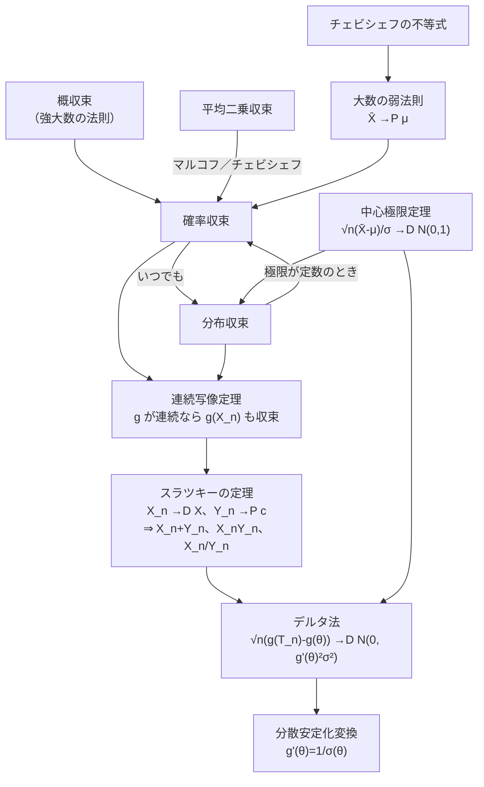

# 確率変数と分布の収束

## 結論（3行まとめ）

1. **収束には3種類あり、強さの順に「平均二乗収束 ⇒ 確率収束 ⇒ 分布収束」です。** 平均二乗収束から確率収束を導くのが**マルコフ・チェビシェフの不等式**、定数に確率収束するのが**大数の弱法則**、分布収束するのが**中心極限定理**です。
2. **収束の性質を使いまわす道具が「連続写像定理」「スラツキーの定理」「デルタ法」です。** 連続関数で写しても収束は保たれ（連続写像定理）、分布収束と「定数への確率収束」は足し算・掛け算・割り算ができ（スラツキー）、滑らかな関数 $g$ で写した統計量の漸近分布も求まります（デルタ法）。
3. **デルタ法の応用が分散安定化変換です。** 漸近分散が母数 $\theta$ に依存して困るとき、$g'(\theta) = 1/\sigma(\theta)$ となる $g$ を選ぶと分散が一定になります（ポアソンの $2\sqrt{\cdot}$、二項の $2\arcsin\sqrt{\cdot}$、相関係数のフィッシャーの $z$ など）。

---

## 0. 全体の関係図



| 道具 | 使う場面 |
| --- | --- |
| マルコフ・チェビシェフ | 分布を知らなくても確率の上界を出す。収束の証明の部品 |
| 大数の弱法則 | 標本平均が真の平均に近づく（一致性） |
| 中心極限定理 | 標本平均のゆらぎの形（正規分布） |
| 連続写像定理 | 収束する統計量を連続関数で変換する |
| スラツキーの定理 | 分母の分散推定量を $\sigma$ に置き換えてよい理由（$t$ 統計量） |
| デルタ法 | 平均の関数（比、対数など）の漸近分布 |
| 分散安定化変換 | 漸近分散を母数によらず一定にして、推定・検定を扱いやすくする |

---

## 1. マルコフの不等式とチェビシェフの不等式

### 1-1. マルコフの不等式

$X \ge 0$、$a > 0$ のとき、

$$
\boxed{\ P(X \ge a) \le \frac{E[X]}{a}\ }
$$

**証明**：$a\cdot\mathbf{1}[X \ge a] \le X$ がつねに成り立つ（$X \ge a$ なら左辺は $a \le X$、そうでなければ左辺は $0 \le X$）。両辺の期待値をとると $a\,P(X \ge a) \le E[X]$。$\qquad\blacksquare$

**拡張**：任意の確率変数 $X$、$r > 0$ に対して $P(\lvert X\rvert \ge a) \le \dfrac{E[\lvert X\rvert^r]}{a^r}$。

### 1-2. チェビシェフの不等式

平均 $\mu$、分散 $\sigma^2$ の確率変数 $X$ について、$k > 0$ なら、

$$
\boxed{\ P(\lvert X - \mu\rvert \ge k) \le \frac{\sigma^2}{k^2}\ }\qquad\text{（$k$ を $\sigma$ の何倍かで書くと}\ P(\lvert X - \mu\rvert \ge k\sigma) \le \tfrac{1}{k^2}\text{）}
$$

**証明**：マルコフの不等式を、非負の確率変数 $(X - \mu)^2$ と $a = k^2$ に使うと、

$$
P\bigl((X - \mu)^2 \ge k^2\bigr) \le \frac{E[(X - \mu)^2]}{k^2} = \frac{\sigma^2}{k^2}\qquad\blacksquare
$$

### 1-3. 図と数値


| 例 | 真の値 | 上界 |
| --- | --- | --- |
| マルコフ：$X \sim Exp(1)$、$P(X \ge 3)$ | $e^{-3} = 0.0498$ | $E[X]/3 = 0.333$ |
| チェビシェフ：$N(0, 1)$、$P(\lvert X\rvert \ge 2)$ | $0.0455$ | $1/4 = 0.25$ |
| チェビシェフ：$Exp(1)$、$P(\lvert X - 1\rvert \ge 2)$ | $0.0498$ | $0.25$ |

- 上界は**かなり緩い**ですが、**分布を知らなくても、平均と分散だけで使える**のが強みです。
- **等号が成り立つ分布もある**ので、一般にはこれ以上改善できません。たとえば $P(X = \pm 2) = \frac18$（各）、$P(X = 0) = \frac34$ なら、$\sigma^2 = 1$、$P(\lvert X\rvert \ge 2) = \frac14 = \frac{\sigma^2}{2^2}$（シミュレーションでも確認済み）。

---

## 2. 3つの収束と、その関係

### 2-1. 定義

$X_1, X_2, \dots$ と $X$ を確率変数とします。

| 収束 | 記号 | 定義 |
| --- | --- | --- |
| **平均二乗収束** | $X_n \xrightarrow{L^2} X$ | $E\bigl[(X_n - X)^2\bigr] \to 0$ |
| **確率収束** | $X_n \xrightarrow{P} X$ | すべての $\varepsilon > 0$ について $P(\lvert X_n - X\rvert > \varepsilon) \to 0$ |
| **分布収束** | $X_n \xrightarrow{D} X$ | $X$ の分布関数 $F$ の**連続点**で $F_n(x) \to F(x)$ |

**分布収束の同値な言い換え**：

- 有界連続な関数 $h$ すべてについて $E[h(X_n)] \to E[h(X)]$。
- 特性関数が各点で収束（$\varphi_n(t) \to \varphi(t)$）：**レヴィの連続性定理**（[連続性定理](./連続性定理.md)）。積率母関数が原点の近くで存在するなら、積率母関数の収束でも判定できます。

> [!NOTE]
> **概収束**（$P(\lim X_n = X) = 1$）は確率収束より強い収束で、**強大数の法則**の主張です。このノートでは、確率収束との関係だけ図に入れています。

### 2-2. 含意関係：強い収束から弱い収束へ

$$
\text{概収束} \Rightarrow \text{確率収束} \Rightarrow \text{分布収束},\qquad \text{平均二乗収束} \Rightarrow \text{確率収束}
$$

**① 平均二乗収束 ⇒ 確率収束**（マルコフ・チェビシェフ）：$P(\lvert X_n - X\rvert > \varepsilon) \le \dfrac{E[(X_n - X)^2]}{\varepsilon^2} \to 0$。

**② 確率収束 ⇒ 分布収束**：$F_n(x) = P(X_n \le x)$ を、$F(x) = P(X \le x)$ を使って上下から挟みます。$\varepsilon > 0$ を固定し、$A_n = \{\lvert X_n - X\rvert > \varepsilon\}$（$X_n$ が $X$ から遠い事象）とおきます。確率収束の仮定より $P(A_n) \to 0$ です。

**(上から押さえる)** $X_n \le x$ が起きたとき、次の2通りに分けます。

- $A_n$ が起きない（$\lvert X_n - X\rvert \le \varepsilon$）なら、$X \le X_n + \varepsilon \le x + \varepsilon$。
- $A_n$ が起きる。

よって、次の包含関係が成り立ちます。

$$
\{X_n \le x\} \subset \{X \le x + \varepsilon\} \cup A_n
$$

和集合の確率は各確率の和以下なので、

$$
F_n(x) \le F(x + \varepsilon) + P(A_n)
$$

**(下から押さえる)** 同様に、$X \le x - \varepsilon$ が起きて $A_n$ が起きないなら $X_n \le X + \varepsilon \le x$ です。よって

$$
\{X \le x - \varepsilon\} \subset \{X_n \le x\} \cup A_n
\ \Rightarrow\ F(x - \varepsilon) \le F_n(x) + P(A_n)
$$

**(まとめ)** 2つを合わせると

$$
F(x - \varepsilon) - P(A_n) \le F_n(x) \le F(x + \varepsilon) + P(A_n)
$$

**(極限を取る)**

1. $n \to \infty$ で $P(A_n) \to 0$ なので、$F(x - \varepsilon) \le \liminf F_n(x) \le \limsup F_n(x) \le F(x + \varepsilon)$。
2. $\varepsilon \to 0$ とすると、$F$ が $x$ で連続なら両端とも $F(x)$ に近づく。
3. 挟み撃ちで $F_n(x) \to F(x)$。

**なぜ連続点だけか**：$\varepsilon \to 0$ で $F(x \pm \varepsilon) \to F(x)$ となるには $F$ が $x$ で連続である必要があります。ジャンプのある点では左右の極限が食い違うためです。

**③ 極限が定数なら、分布収束 ⇒ 確率収束**：$X_n \xrightarrow{D} c$（定数）なら、

$$
P(\lvert X_n - c\rvert > \varepsilon) \le 1 - F_n(c + \varepsilon) + F_n(c - \varepsilon) \to 1 - 1 + 0 = 0
$$

### 2-3. 逆は成り立たない（反例）


| 反例 | 内容 |
| --- | --- |
| **確率収束 ⇏ 平均二乗収束** | $X_n = n$（確率 $\frac1n$）、$X_n = 0$（確率 $1 - \frac1n$）。$P(\lvert X_n\rvert > \varepsilon) = \frac1n \to 0$ だが、$E[X_n^2] = n \to \infty$。**まれに起きる大きな値**が期待値を壊す（右図）。 |
| **分布収束 ⇏ 確率収束** | $X \sim N(0, 1)$、$X_n = -X$。どの $X_n$ も $N(0, 1)$ なので $X_n \xrightarrow{D} X$。しかし $P(\lvert X_n - X\rvert > 0.5) = P(2\lvert X\rvert > 0.5) = 0.8026$ で、$n$ によらず一定（$0$ に近づかない）。 |

**違いの本質**：確率収束・平均二乗収束は「$X_n$ の**値**が $X$ に近づく」（同じ確率空間の上で比べる）、分布収束は「**分布の形**が近づく」（値そのものは近づかなくてよい）ことです。

---

## 3. 大数の弱法則

$X_1, \dots, X_n$ が独立で同分布、平均 $\mu$、分散 $\sigma^2 < \infty$ とします。$\bar{X}_n = \frac1n\sum X_i$ について、

$$
\boxed{\ \bar{X}_n \xrightarrow{P} \mu\ }
$$

**証明（チェビシェフの不等式）**：$E[\bar{X}_n] = \mu$、$V[\bar{X}_n] = \sigma^2/n$ なので、

$$
P(\lvert\bar{X}_n - \mu\rvert > \varepsilon) \le \frac{V[\bar{X}_n]}{\varepsilon^2} = \frac{\sigma^2}{n\varepsilon^2} \to 0\qquad\blacksquare
$$

同時に $E[(\bar{X}_n - \mu)^2] = \sigma^2/n \to 0$ なので、**平均二乗収束**もしています。


$X_i \sim Exp(1)$（$\mu = \sigma = 1$）、$\varepsilon = 0.2$ の場合です（左図。標本平均は $Ga(n, n)$ に従うので、真の値は厳密に計算）。

| $n$ | $P(\lvert\bar{X}_n - 1\rvert > 0.2)$ | チェビシェフの上界 $\frac{25}{n}$ |
| --- | --- | --- |
| 10 | $0.526$ | $1$（意味なし） |
| 50 | $0.155$ | $0.5$ |
| 100 | $0.045$ | $0.25$ |
| 400 | $8.8\times10^{-5}$ | $0.0625$ |

- **上界は緩い**（真の値は指数的に小さくなるが、上界は $1/n$ でしか減らない）。それでも「$0$ に収束する」ことの証明には十分です。
- **分散が有限でなくても**、$E[\lvert X\rvert] < \infty$ なら大数の弱法則は成り立ちます（ヒンチンの定理）。**概収束**まで言えるのが強大数の法則です。
- 統計での意味：**標本平均は母平均の一致推定量**です。

---

## 4. 中心極限定理

$X_1, \dots, X_n$ が独立で同分布、平均 $\mu$、分散 $\sigma^2 \in (0, \infty)$ のとき、

$$
\boxed{\ \frac{\sqrt{n}(\bar{X}_n - \mu)}{\sigma} \xrightarrow{D} N(0, 1)\ }
$$

**証明のあらすじ**：標準化 $Z_i = (X_i - \mu)/\sigma$ の積率母関数 $M(t) = 1 + \frac{t^2}{2} + o(t^2)$ から、標準化した平均の積率母関数が

$$
\left[M\!\left(\frac{t}{\sqrt{n}}\right)\right]^n = \left[1 + \frac{t^2}{2n} + o\!\left(\frac1n\right)\right]^n \to e^{t^2/2}
$$

となり、標準正規分布の積率母関数に収束します（連続性定理で分布収束が従う）。詳しくは [積率母関数を使った正規性の証明](./積率母関数を使った正規性の証明.md) を参照してください。


$X_i \sim Exp(1)$（右に歪んだ分布）で、標準化した標本平均と標準正規分布の分布関数の**最大の差**（コルモゴロフ距離）を厳密に計算しました。

| $n$ | 1 | 2 | 5 | 30 | 100 | 1000 |
| --- | --- | --- | --- | --- | --- | --- |
| 最大差 | $0.158$ | $0.095$ | $0.060$ | $0.024$ | $0.013$ | $0.0042$ |

- $n$ が大きくなると、元の分布の歪みが消えて正規分布に近づく（図の左と中）。
- 近づく速さは $n^{-1/2}$ の程度（右図）。**ベリー・エッセンの定理**で、最大差が $C\,\rho/(\sigma^3\sqrt{n})$ 以下と保証されます（$\rho = E\lvert X - \mu\rvert^3$）。
- **大数の法則との違い**：大数の法則は「**どこへ**行くか」（$\mu$）、中心極限定理は「そのまわりの**ゆらぎの形**」（$1/\sqrt{n}$ のスケールで正規分布）を述べます。

---

## 5. 連続写像定理

$g$ が連続な関数なら、収束は $g$ で写しても保たれます。

$$
\boxed{\ X_n \xrightarrow{P} X\ \Rightarrow\ g(X_n) \xrightarrow{P} g(X),\qquad X_n \xrightarrow{D} X\ \Rightarrow\ g(X_n) \xrightarrow{D} g(X)\ }
$$

（$g$ が $X$ の取りうる値の上でほぼ至るところ連続なら十分。$g$ の不連続点に $X$ がほとんど入らなければよい）。

**例**：

| 例 | 使う収束 | 結論 |
| --- | --- | --- |
| ① $\left(\dfrac{\sqrt{n}(\bar{X}_n - \mu)}{\sigma}\right)^2$ | CLT + $g(x) = x^2$ | $\xrightarrow{D} \chi^2(1)$（標準正規の2乗） |
| ② $e^{\bar{X}_n}$ | 大数の法則 + $g = \exp$ | $\xrightarrow{P} e^\mu$ |
| ③ $S = \sqrt{S^2}$ | $S^2 \xrightarrow{P} \sigma^2$ + $g = \sqrt{\cdot}$ | $S \xrightarrow{P} \sigma$ |
| ④ $\log\bar{X}_n$ | 大数の法則 + $g = \log$（$\mu > 0$） | $\xrightarrow{P} \log\mu$ |

> [!WARNING]
> **確率収束は、2つの変数の和・積でも保たれます**（$X_n \xrightarrow{P} a$、$Y_n \xrightarrow{P} b$ なら $X_n + Y_n \xrightarrow{P} a + b$）。**分布収束はそうではありません**。$X_n \xrightarrow{D} X$、$Y_n \xrightarrow{D} Y$ だけでは、$X_n + Y_n$ の分布収束は言えません（2つの同時分布が必要）。これを補うのがスラツキーの定理です。

---

## 6. スラツキーの定理

$X_n \xrightarrow{D} X$、$Y_n \xrightarrow{P} c$（$c$ は**定数**）のとき、

$$
\boxed{\ X_n + Y_n \xrightarrow{D} X + c,\qquad X_nY_n \xrightarrow{D} cX,\qquad \frac{X_n}{Y_n} \xrightarrow{D} \frac{X}{c}\ (c \ne 0)\ }
$$

**なぜ成り立つか**：$Y_n$ が定数 $c$ に確率収束するなら、$(X_n, Y_n) \xrightarrow{D} (X, c)$（$Y_n$ にゆらぎがないので同時分布の心配が不要）。これに連続写像定理（$g(x, y) = x + y$ など）を使います。

### 6-1. 応用：標本分散で置き換えた $t$ 統計量

母集団が正規でなくても（分散 $\sigma^2$ が有限）、

$$
T_n = \frac{\sqrt{n}(\bar{X}_n - \mu)}{S_n} = \underbrace{\frac{\sqrt{n}(\bar{X}_n - \mu)}{\sigma}}_{\xrightarrow{D} N(0,1)\ \text{（CLT）}}\ \Big/\ \underbrace{\frac{S_n}{\sigma}}_{\xrightarrow{P} 1}\ \xrightarrow{D}\ N(0, 1)
$$

**分母の $\sigma$ を標本の $S_n$ で置き換えても、漸近分布は変わりません。** 正規母集団なら厳密に $t(n-1)$ ですが、一般の母集団でも $n$ が大きければ標準正規分布に近づきます（[正規母集団の標本分布](./正規母集団の標本分布.md)）。

**数値で確認**：$X_i \sim Exp(1)$ で、$P(\lvert T_n\rvert > 1.96)$（正規分布なら $0.05$）を調べました。

| $n$ | 10 | 30 | 100 | 1000 |
| --- | --- | --- | --- | --- |
| $S_n$ の平均（$\sigma = 1$） | $0.924$ | $0.971$ | $0.991$ | $0.9993$ |
| $P(\lvert T_n\rvert > 1.96)$ | $0.130$ | $0.084$ | $0.061$ | $0.052$ |
| 参考：$P(\lvert Z\rvert > 1.96)$（$\sigma$ 既知） | $0.044$ | $0.049$ | $0.049$ | $0.050$ |

$n$ が大きくなると、$S_n \to 1 = \sigma$ となり、$T_n$ の裾の確率も $0.05$ に近づきます（歪んだ分布では収束が遅い）。

> [!IMPORTANT]
> **$Y_n$ が定数でなく、ただ分布収束するだけでは成り立ちません。** たとえば $X_n = Z$、$Y_n = -Z$（$Z \sim N(0, 1)$）は、どちらも $N(0, 1)$ に分布収束しますが、$X_n + Y_n = 0$ で、独立な $N(0,1)$ の和 $N(0, 2)$ にはなりません。

---

## 7. デルタ法

統計量 $T_n$（たとえば標本平均）が $\sqrt{n}(T_n - \theta) \xrightarrow{D} N(0, \sigma^2)$ を満たし、$g$ が $\theta$ で微分可能で $g'(\theta) \ne 0$ のとき、

$$
\boxed{\ \sqrt{n}\bigl(g(T_n) - g(\theta)\bigr) \xrightarrow{D} N\bigl(0,\ g'(\theta)^2\sigma^2\bigr)\ }
$$

**証明（テイラー展開 + スラツキー）**：平均値の定理で $g(T_n) - g(\theta) = g'(\tilde{\theta}_n)(T_n - \theta)$（$\tilde{\theta}_n$ は $T_n$ と $\theta$ の間）。$T_n \xrightarrow{P} \theta$ なので $\tilde{\theta}_n \xrightarrow{P} \theta$、連続写像定理で $g'(\tilde{\theta}_n) \xrightarrow{P} g'(\theta)$。したがって、

$$
\sqrt{n}\bigl(g(T_n) - g(\theta)\bigr) = \underbrace{g'(\tilde{\theta}_n)}_{\xrightarrow{P} g'(\theta)}\cdot\underbrace{\sqrt{n}(T_n - \theta)}_{\xrightarrow{D} N(0, \sigma^2)} \xrightarrow{D} g'(\theta)\cdot N(0, \sigma^2)\qquad\blacksquare
$$

**要するに**：$g$ を**接線で近似**して、分散に $g'(\theta)^2$ を掛けるだけです。

### 7-1. 例：$1/\bar{X}_n$

$X_i \sim Exp$（平均 $\mu = 2$、$\sigma = 2$）、$n = 100$ のとき、$g(x) = 1/x$、$g'(\mu) = -1/4$ なので、

$$
\frac{1}{\bar{X}_n} \approx N\!\left(\frac12,\ \frac{g'(\mu)^2\sigma^2}{n}\right) = N\!\left(0.5,\ \frac{(1/16)\cdot4}{100}\right) = N(0.5,\ 0.0025)
$$


| 量 | デルタ法 | シミュレーション（30万回） |
| --- | --- | --- |
| $1/\bar{X}$ の平均 | $0.5$ | $0.505$ |
| $1/\bar{X}$ の分散 | $0.0025$ | $0.00261$ |

右図のように分布は近似されていますが、**有限の $n$ では誤差が残ります**（分散は約4%大きく、右に少し歪む）。デルタ法は $n \to \infty$ の漸近的な近似です。

### 7-2. 例（解析的）

- **ロジット**：$g(p) = \log\frac{p}{1 - p}$、$g'(p) = \frac{1}{p(1-p)}$、$\sigma^2 = p(1-p)$ より、$\sqrt{n}\bigl(g(\hat{p}) - g(p)\bigr) \xrightarrow{D} N\!\left(0, \frac{1}{p(1-p)}\right)$。
- **多変量版**：$\sqrt{n}(\vec{T}_n - \vec\theta) \xrightarrow{D} N(\vec0, \Sigma)$ なら、$\sqrt{n}\bigl(g(\vec{T}_n) - g(\vec\theta)\bigr) \xrightarrow{D} N\bigl(0,\ \nabla g^\top\Sigma\nabla g\bigr)$。比 $\bar{X}/\bar{Y}$ の分散などに使う。

### 7-3. $g'(\theta) = 0$ のとき（2次のデルタ法）

接線が水平だと分散が $0$ になって使えません。**2次の項まで展開**すると、

$$
n\bigl(g(T_n) - g(\theta)\bigr) \xrightarrow{D} \frac{g''(\theta)\sigma^2}{2}\,\chi^2(1)
$$

**例**：$g(x) = x^2$、$\theta = 0$、$\sigma = 1$ なら、$n\bar{X}_n^2 \xrightarrow{D} \chi^2(1)$（連続写像定理の例①と同じ結果）。シミュレーション（$n = 50$）で $n\bar{X}^2$ の平均は $1.002$（$\chi^2(1)$ の平均 $1$）、$P(n\bar{X}^2 > 3.84) = 0.0504$（理論値 $0.05$）でした。

---

## 8. 分散安定化変換

### 8-1. 問題

統計量が $\sqrt{n}(T_n - \theta) \xrightarrow{D} N\bigl(0, \sigma^2(\theta)\bigr)$ のように、**漸近分散が未知の母数 $\theta$ に依存する**ことがよくあります。これでは信頼区間や検定で、分散を推定する手間と誤差が加わります。

### 8-2. 解決法

デルタ法より、$g(T_n)$ の漸近分散は $g'(\theta)^2\sigma^2(\theta)$。これを**定数にする**には、

$$
g'(\theta) = \frac{1}{\sigma(\theta)}\quad\Rightarrow\quad\boxed{\ g(\theta) = \int\frac{d\theta}{\sigma(\theta)}\ }
$$

とします。すると $\sqrt{n}\bigl(g(T_n) - g(\theta)\bigr) \xrightarrow{D} N(0, 1)$ となり、**分散が $\theta$ によらず $1$** になります。

### 8-3. 代表例

| 状況 | $\sigma^2(\theta)$ | $g(\theta) = \int\frac{d\theta}{\sigma}$ | 安定化後 |
| --- | --- | --- | --- |
| ポアソン（$\bar{X}$、平均 $\theta$） | $\theta$ | $2\sqrt{\theta}$ | $\sqrt{n}(2\sqrt{\bar{X}} - 2\sqrt{\theta}) \to N(0, 1)$ |
| 二項（$\hat{p}$） | $p(1-p)$ | $2\arcsin\sqrt{p}$ | $\sqrt{n}(2\arcsin\sqrt{\hat{p}} - 2\arcsin\sqrt{p}) \to N(0, 1)$ |
| 指数・ガンマ（$\sigma = \theta$ に比例） | $\theta^2$ | $\log\theta$ | $\sqrt{n}(\log\bar{X} - \log\theta) \to N(0, 1)$ |
| 標本相関係数 $r$ | $(1-\rho^2)^2$ | $\operatorname{arctanh}\rho = \frac12\log\frac{1+\rho}{1-\rho}$ | $\sqrt{n}(\operatorname{arctanh} r - \operatorname{arctanh}\rho) \to N(0, 1)$（フィッシャーの $z$ 変換） |
| 標本分散（正規） | $2\sigma^4$ | $\sqrt{2}\log\sigma^2$ に比例 | $\log S^2$ の分散が $\approx 2/n$（定数） |

**導出の確認**（二項）：$\dfrac{d}{dp}\,2\arcsin\sqrt{p} = 2\cdot\dfrac{1}{\sqrt{1-p}}\cdot\dfrac{1}{2\sqrt{p}} = \dfrac{1}{\sqrt{p(1-p)}} = \dfrac{1}{\sigma(p)}$。

### 8-4. 数値で確認


**ポアソン分布**（厳密に計算）：$V[2\sqrt{X}]$ は $\lambda$ が大きいほど $1$ に近づき、$V[X] = \lambda$ のようには増えません。

| $\lambda$ | 1 | 4 | 10 | 30 |
| --- | --- | --- | --- | --- |
| $V[X]$ | $1$ | $4$ | $10$ | $30$ |
| $V[2\sqrt{X}]$ | $1.609$ | $1.223$ | $1.045$ | $1.013$ |

**二項分布**（$n = 30$、厳密に計算）：$4n\,V[\arcsin\sqrt{\hat{p}}]$ は、$p$ が $0$ や $1$ に近すぎなければ $1$ に近い値です。一方、$n\,V[\hat{p}] = p(1-p)$ は $p$ によって変わります。

| $p$ | 0.1 | 0.3 | 0.5 |
| --- | --- | --- | --- |
| $n\,V[\hat{p}] = p(1-p)$ | $0.090$ | $0.210$ | $0.250$ |
| $4n\,V[\arcsin\sqrt{\hat{p}}]$ | $1.336$ | $1.049$ | $1.036$ |

**フィッシャーの $z$ 変換**（$n = 30$、10万回シミュレーション）：$V[r]$ は $\rho$ で大きく変わりますが、$\operatorname{arctanh} r$ の分散は $\rho$ によらず $\frac{1}{n - 3} = 0.0370$ に近い値です。

| $\rho$ | 0 | 0.5 | 0.9 |
| --- | --- | --- | --- |
| $V[r]$ | $0.0346$ | $0.0203$ | $0.0015$ |
| $V[\operatorname{arctanh} r]$ | $0.0372$ | $0.0368$ | $0.0365$ |

> [!TIP]
> $n$ が小さいとき、$\hat{p}$ が $0$ や $1$ に近いとき（図の右端）は近似が悪くなります。**漸近的な近似**であることを忘れないでください。

### 8-5. 何に役立つか

- **分散が一定になる**ので、等分散を仮定する手法（回帰分析、分散分析、$t$ 検定）が使いやすくなります。
- **正規分布への近づきが良くなる**ことも多く、信頼区間が書きやすくなります。たとえば相関係数の信頼区間は、$z = \operatorname{arctanh} r$ で $z \pm \frac{1.96}{\sqrt{n-3}}$ を作り、$\tanh$ で戻します。
- ポアソン（件数データ）には $\sqrt{\cdot}$、割合には $\arcsin\sqrt{\cdot}$、比例的なばらつきには $\log$ を使う、という使い分けです。

---

## 9. 定理と道具の一覧

| 定理・道具 | 主張 | 証明に使うもの |
| --- | --- | --- |
| マルコフ | $P(X \ge a) \le E[X]/a$ | $a\mathbf{1}[X \ge a] \le X$ |
| チェビシェフ | $P(\lvert X - \mu\rvert \ge k) \le \sigma^2/k^2$ | マルコフ（$(X-\mu)^2$ に適用） |
| 大数の弱法則 | $\bar{X}_n \xrightarrow{P} \mu$ | チェビシェフ（$V[\bar{X}] = \sigma^2/n$） |
| 中心極限定理 | $\sqrt{n}(\bar{X}_n - \mu)/\sigma \xrightarrow{D} N(0, 1)$ | 積率母関数（特性関数）と連続性定理 |
| 連続写像定理 | $g$ 連続なら $g(X_n)$ も同じ収束 | 収束の定義 |
| スラツキー | $X_n \xrightarrow{D} X$、$Y_n \xrightarrow{P} c$ ⇒ 和・積・商 | $(X_n, Y_n) \xrightarrow{D} (X, c)$ + 連続写像 |
| デルタ法 | $\sqrt{n}(g(T_n) - g(\theta)) \xrightarrow{D} N(0, g'(\theta)^2\sigma^2)$ | 平均値の定理 + スラツキー |
| 分散安定化 | $g'(\theta) = 1/\sigma(\theta)$ で漸近分散が一定 | デルタ法 |

---

## 10. 試験での使い方

- **収束の種類を区別する**：「値が近づく」（確率・平均二乗）か「分布の形が近づく」（分布収束）か。含意の向き（平均二乗 ⇒ 確率 ⇒ 分布）と、**逆は一般に偽**であること、**定数への分布収束だけは確率収束と同値**であることを使い分ける。
- **大数の弱法則**はチェビシェフで $\sigma^2/(n\varepsilon^2)$ と書く。**中心極限定理**は標準化を忘れない（$\sqrt{n}$ と $\sigma$）。
- **分母に $S$ や $\hat{\sigma}$ が出てきたら**、$\hat{\sigma} \xrightarrow{P} \sigma$ を示してスラツキーを使う。
- **$g(\bar{X})$ の分布を問われたら**、デルタ法：$g'(\mu)^2\sigma^2/n$。$g'(\mu) = 0$ のときは2次のデルタ法（$\chi^2(1)$）。
- **分散安定化**は $g(\theta) = \int d\theta/\sigma(\theta)$ を作る。積分を計算する問題が多い。
- **「$\bar{X}$ と $S^2$ は独立」** は正規母集団だけの性質。一般の母集団ではスラツキーを使う。

---

## まとめ

- **関係**：平均二乗収束 ⇒ 確率収束 ⇒ 分布収束（逆は一般に偽、定数への分布収束は確率収束と同値）。
- **不等式 → 法則**：マルコフ → チェビシェフ → 大数の弱法則（確率収束）。中心極限定理は分布収束。
- **収束の道具**：連続写像定理（連続関数で写しても収束は保たれる）、スラツキー（分布収束 + 定数への確率収束）、デルタ法（$g'(\theta)^2\sigma^2$）。
- **応用**：分散安定化変換 $g(\theta) = \int d\theta/\sigma(\theta)$（$2\sqrt{\cdot}$、$2\arcsin\sqrt{\cdot}$、$\log$、フィッシャーの $z$）。

---

## 図の作り方

図と数値の確認は [script/plot_convergence.py](./script/plot_convergence.py) で行っています。リポジトリのルートで次を実行すると `images/` に出力されます（上の数値の確認結果は標準出力に表示されます）。

```bash
uv run --with matplotlib --with numpy --with scipy python 一般教養/数理統計学/script/plot_convergence.py
```
