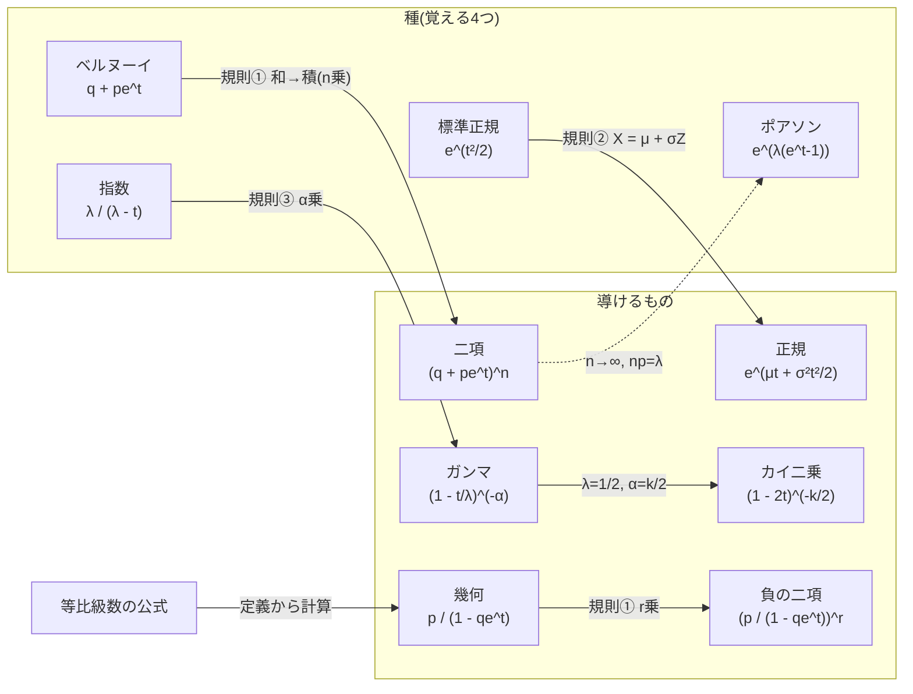

# 積率母関数の覚え方（代表的な確率分布）

## 結論（覚えるのは「4つの種」と「3つの規則」だけ）

1. **種（4つ）**：ベルヌーイ $q + pe^t$、ポアソン $e^{\lambda(e^t-1)}$、指数 $\dfrac{\lambda}{\lambda - t}$、標準正規 $e^{t^2/2}$。
2. **規則（3つ）**：①独立な和 → 積（べき乗）、②一次変換 $aX + b$ → $e^{bt}M(at)$、③ガンマは指数の $\alpha$ 乗。
3. **残りは全部導けます**：二項・負の二項・幾何・ガンマ・カイ二乗・一般の正規。覚える式は4個、規則は3個です。

> [!NOTE]
> 各分布の導出や性質は [代表的な確率分布](./代表的な確率分布.md)、母関数そのものの意味は [確率母関数・積率母関数・特性関数](./確率母関数・積率母関数・特性関数.md) を参照してください。



- 実線は変換規則による導出、点線は極限。ポアソンは種として覚えるが、二項の極限としても出る。
- 幾何だけは、定義 $P(X=k)=q^kp$ から等比級数の公式1つで出る（種ではない）。

---

## 1. 4つの種

$q = 1 - p$ とします。**どれも定義 $E[e^{tX}]$ を1〜2行で計算すれば出る**ので、忘れたらその場で作れます。

| 種 | $M(t)$ | その場での作り方 |
| --- | --- | --- |
| ベルヌーイ | $q + pe^t$ | $M(t) = q\cdot e^{t\cdot0} + p\cdot e^{t\cdot1}$（値0と1の2点だけ） |
| ポアソン | $e^{\lambda(e^t - 1)}$ | $\sum_k e^{tk}\dfrac{\lambda^ke^{-\lambda}}{k!} = e^{-\lambda}\sum_k\dfrac{(\lambda e^t)^k}{k!} = e^{-\lambda}e^{\lambda e^t}$（指数関数の級数） |
| 指数 | $\dfrac{\lambda}{\lambda - t}$ | $\int_0^\infty\lambda e^{-\lambda x}e^{tx}dx = \int_0^\infty\lambda e^{-(\lambda - t)x}dx$（**密度の $\lambda$ を $\lambda - t$ に置き換える**） |
| 標準正規 | $e^{t^2/2}$ | $e^{tz - z^2/2} = e^{t^2/2}e^{-(z-t)^2/2}$（平方完成）で、残りは正規密度の積分で1 |

- ポアソンだけは、「$e^t - 1$」の形（$t=0$ で0になる）が覚えどころです。
- 存在範囲：ベルヌーイ・ポアソン・標準正規は全 $t$。指数は $t < \lambda$（$\lambda - t > 0$ でないと積分が発散）。

---

## 2. 3つの規則

### 規則① 独立な和 → 積

$X, Y$ が独立なら $M_{X+Y}(t) = M_X(t)M_Y(t)$。同じ分布の $n$ 個の和は **$n$ 乗**。

- **二項**：ベルヌーイの $n$ 個の和なので $(q + pe^t)^n$。
- **負の二項**：幾何の $r$ 個の和なので $\left(\dfrac{p}{1 - qe^t}\right)^r$。
- **幾何**：定義 $P(X=k) = q^kp$（$k = 0, 1, \dots$）から、等比級数の公式1つで出ます。

$$M(t) = \sum_{k=0}^\infty e^{tk}q^kp = p\sum_{k=0}^\infty(qe^t)^k = \frac{p}{1 - qe^t}\quad(qe^t < 1)$$

> [!TIP]
> 成功した回も数える流儀（値が $1, 2, \dots$）では $e^t$ が1つ余分に掛かって $\dfrac{pe^t}{1 - qe^t}$ になります。このノートでは [代表的な確率分布](./代表的な確率分布.md) に合わせて「失敗の回数」（$0, 1, 2, \dots$）です。

### 規則② 一次変換 $aX + b$

$M_{aX+b}(t) = E[e^{t(aX+b)}] = e^{bt}M_X(at)$。

- **正規**：$X = \mu + \sigma Z$（$Z$ は標準正規）なので

$$M_X(t) = e^{\mu t}M_Z(\sigma t) = e^{\mu t}e^{\sigma^2t^2/2}$$

- 「指数の肩が $\mu t + \sigma^2t^2/2$」という形も、この規則から自動的に出ます。

### 規則③ ガンマは指数の $\alpha$ 乗

$\alpha$ が整数なら、$Ga(\alpha, \lambda)$ は指数 $Exp(\lambda)$ の $\alpha$ 個の和（規則①）で、

$$M(t) = \left(\frac{\lambda}{\lambda - t}\right)^\alpha = \left(1 - \frac{t}{\lambda}\right)^{-\alpha}$$

非整数の $\alpha$ でも同じ形で成り立ちます。**$\alpha$ が指数の肩、$\lambda$ は $t$ を割る**。

**カイ二乗**：2通りの導き方があり、好きな方で十分です。

- (a) $\chi^2(k) = Ga(\frac{k}{2}, \frac12)$ に $\lambda = \frac12$、$\alpha = \frac{k}{2}$ を入れる：$\left(1 - \dfrac{t}{1/2}\right)^{-k/2} = (1 - 2t)^{-k/2}$。
- (b) $Z^2$ のMGFを直接計算（ガウス積分）：$E[e^{tZ^2}] = \displaystyle\int\frac{1}{\sqrt{2\pi}}e^{-(1-2t)z^2/2}dz = (1 - 2t)^{-1/2}$。自由度 $k$ は独立な $k$ 個の和なので $k$ 乗：$(1-2t)^{-k/2}$。

> [!NOTE]
> 正規の $E[e^{tZ}]$ と、カイ二乗の $E[e^{tZ^2}]$ は別の量です（指数部が $Z$ か $Z^2$ か）。カイ二乗から正規のMGFは出ません。

---

## 3. 導出で得られる一覧（覚えなくてよい結果表）

| 分布 | $M(t)$ | 存在範囲 | どの規則で出るか |
| --- | --- | --- | --- |
| 二項 $B(n, p)$ | $(q + pe^t)^n$ | 全 $t$ | ベルヌーイの $n$ 乗（規則①） |
| ポアソン $Po(\lambda)$ | $\exp\bigl(\lambda(e^t - 1)\bigr)$ | 全 $t$ | 種 |
| 幾何 $Ge(p)$ | $\dfrac{p}{1 - qe^t}$ | $qe^t < 1$ | 等比級数 |
| 負の二項 $NB(r, p)$ | $\left(\dfrac{p}{1 - qe^t}\right)^r$ | $qe^t < 1$ | 幾何の $r$ 乗（規則①） |
| 指数 $Exp(\lambda)$ | $\dfrac{\lambda}{\lambda - t}$ | $t < \lambda$ | 種 |
| ガンマ $Ga(\alpha, \lambda)$ | $\left(1 - \dfrac{t}{\lambda}\right)^{-\alpha}$ | $t < \lambda$ | 指数の $\alpha$ 乗（規則③） |
| カイ二乗 $\chi^2(k)$ | $(1 - 2t)^{-k/2}$ | $t < \frac12$ | ガンマで $\lambda = \frac12$、$\alpha = \frac{k}{2}$ |
| 正規 $N(\mu, \sigma^2)$ | $\exp\left(\mu t + \dfrac{\sigma^2t^2}{2}\right)$ | 全 $t$ | 標準正規に規則② |

**覚えなくてよい分布**：超幾何（閉じた簡単な形がない）、ワイブル（閉じた形で書けない）、ベータ（合流型超幾何関数 ${}_1F_1$ になる）。

**二項 → ポアソン**：ポアソンの種は、二項の極限（$np = \lambda$ を固定して $n \to \infty$）からも出ます。

$$\left(1 + \frac{\lambda(e^t - 1)}{n}\right)^n \to e^{\lambda(e^t - 1)}$$

---

## 4. 忘れたときの検算

### 4-1. $M(0) = 1$

$M(0) = E[e^0] = 1$。$t = 0$ を代入して 1 になるかを確かめます。$(p + q)^n = 1$、$e^{\lambda(1-1)} = 1$、$\dfrac{p}{1-q} = 1$、$\dfrac{\lambda}{\lambda} = 1$ など。ポアソンの「$-1$」を忘れたときは、これで気づけます。

### 4-2. 対数をとって微分する

$K(t) = \log M(t)$ とすると、$K'(0) = $ 平均、$K''(0) = $ 分散。

| 分布 | $K(t) = \log M(t)$ | $K'(0)$ | $K''(0)$ |
| --- | --- | --- | --- |
| 二項 | $n\log(q + pe^t)$ | $np$ | $npq$ |
| ポアソン | $\lambda(e^t - 1)$ | $\lambda$ | $\lambda$ |
| 幾何 | $\log p - \log(1 - qe^t)$ | $\dfrac{q}{p}$ | $\dfrac{q}{p^2}$ |
| 指数 | $\log\lambda - \log(\lambda - t)$ | $\dfrac{1}{\lambda}$ | $\dfrac{1}{\lambda^2}$ |
| ガンマ | $-\alpha\log\left(1 - \dfrac{t}{\lambda}\right)$ | $\dfrac{\alpha}{\lambda}$ | $\dfrac{\alpha}{\lambda^2}$ |
| カイ二乗 | $-\dfrac{k}{2}\log(1 - 2t)$ | $k$ | $2k$ |
| 正規 | $\mu t + \dfrac{\sigma^2t^2}{2}$ | $\mu$ | $\sigma^2$ |

平均と分散が [代表的な確率分布](./代表的な確率分布.md) の一覧表と一致するかで確かめます。

### 4-3. 存在範囲

| 範囲 | 該当 | 理由 |
| --- | --- | --- |
| 全 $t$ | 二項、ポアソン、正規 | 値が有界、または裾が十分軽い |
| $t < \lambda$ | 指数、ガンマ | $e^{tx}e^{-\lambda x}$ が積分できる条件 |
| $t < \frac12$ | カイ二乗 | $\lambda = \frac12$ |
| $qe^t < 1$ | 幾何、負の二項 | 等比級数の収束条件 |

---

## 5. 暗記用ミニテスト

次の積率母関数は、どの分布でしょうか。（答えを隠して考えてください）

| 問 | $M(t)$ | 答え |
| --- | --- | --- |
| 1 | $\exp\bigl(3(e^t - 1)\bigr)$ | $Po(3)$ |
| 2 | $(0.4 + 0.6e^t)^5$ | $B(5, 0.6)$ |
| 3 | $\dfrac{3}{3 - t}$ | $Exp(3)$ |
| 4 | $(1 - t)^{-2}$ | $Ga(2, 1)$ |
| 5 | $(1 - 2t)^{-3}$ | $\chi^2(6)$（$\alpha = 3 = k/2$ より $k = 6$） |
| 6 | $\exp(2t + t^2)$ | $N(2, 2)$（$\sigma^2/2 = 1$ より $\sigma^2 = 2$） |
| 7 | $\dfrac{0.2}{1 - 0.8e^t}$ | $Ge(0.2)$ |
| 8 | $\left(\dfrac{0.5}{1 - 0.5e^t}\right)^4$ | $NB(4, 0.5)$ |

---

## まとめ

- **覚える式は4つ**：ベルヌーイ $q + pe^t$、ポアソン $e^{\lambda(e^t-1)}$、指数 $\dfrac{\lambda}{\lambda-t}$、標準正規 $e^{t^2/2}$。
- **規則は3つ**：独立な和は積（$n$ 乗）、$aX+b$ は $e^{bt}M(at)$、ガンマは指数の $\alpha$ 乗。
- **導けるもの**：二項（ベルヌーイの $n$ 乗）、幾何（等比級数）、負の二項（幾何の $r$ 乗）、ガンマ、カイ二乗（$\lambda=\frac12,\alpha=\frac k2$）、一般の正規（$\mu+\sigma Z$）。
- **検算**：$M(0) = 1$、$\log M$ の微分で平均・分散、存在範囲。

---

## 検算の方法

表に載せた各公式は、定義 $E[e^{tX}]$（和・数値積分）から直接計算した値と、公式の値が一致することを [script/check_mgf_table.py](./script/check_mgf_table.py) で確認しています。平均・分散の確認（$K'(0)$、$K''(0)$）、二項 → ポアソンの極限、$M(0) = 1$ も含みます。リポジトリのルートで次を実行してください。

```bash
uv run --with numpy --with scipy python 一般教養/数理統計学/script/check_mgf_table.py
```
